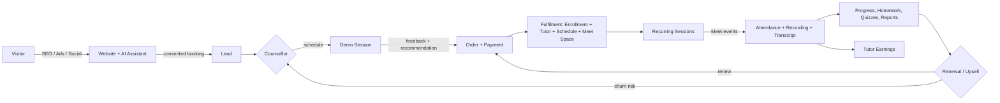

# Tutrain Platform v2 — Software Requirements Specification (SRS)

| Field | Value |
|---|---|
| Document | SRS-TUTRAIN-V2 |
| Version | 1.0 (Draft for tech-team review) |
| Date | 23 Oct 2026 |
| Owner | eQOURSE / Tutrain Product |
| Status | Draft. Becomes baseline after sign-off (§11) |
| Structure | Based on ISO/IEC/IEEE 29148:2018 |

**Requirement keywords.** **MUST** = mandatory for release. **SHOULD** = expected unless explicitly descoped. **MAY** = optional.

**Priority tags.** `[P1]` = Phase 1 (foundation + revenue-critical). `[P2]` = Phase 2. `[P3]` = Phase 3+. Phases are defined in [10-ROADMAP.md](./10-ROADMAP.md).

---

## 1. Introduction

### 1.1 Purpose
This SRS defines the functional and non-functional requirements for **Tutrain Platform v2**, a unified B2C online-tutoring platform. It replaces the current split between `tutrain-backend` (MongoDB) and `student-management` (Firestore), and rebuilds the public website, portals, CRM, LMS, finance and AI capabilities on one architecture.

### 1.2 Scope
In scope:
1. Public marketing website with programmatic SEO and an AI sales assistant that can **book a demo with recorded consent**.
2. Student and parent portal: learning, schedule, recordings, progress, payments.
3. Tutor portal: schedule, availability, classes, LMS tools, earnings.
4. Admin console with department workspaces: Super Admin, Operations, Academics/Quality, Sales/Counselling (CRM), Marketing, Finance, Support, Tutor Acquisition (HR).
5. Live-class integration with Google Meet: automatic attendance, recordings, transcripts and AI summaries.
6. Commerce: plans, custom plans, batches, promos, payments (India and international), invoices, refunds, tutor payouts.
7. CRM and marketing automation: leads, pipelines, tasks, WhatsApp/email/SMS campaigns, attribution.
8. LMS: curriculum, lesson plans, homework, quizzes, resources, report cards, PTMs.
9. AI platform: chatbot, copilots, analytics assistants, and a governed AI gateway.
10. Data migration from MongoDB and Firestore, and decommissioning of both legacy systems.

Out of scope for v2.0: native mobile apps (a PWA is in scope; native apps are `[P3]`), an in-house video-conferencing stack, B2B school licensing, and a marketplace where tutors set their own prices.

### 1.3 Definitions

| Term | Meaning |
|---|---|
| **Learner** | The student receiving tutoring. May be a minor. |
| **Guardian** | Parent or legal guardian who pays and consents for a minor learner. One guardian can have many learners. |
| **Account holder** | The person who owns the login and billing (the guardian for minors, the learner for adults). |
| **Lead** | A prospective customer, before first payment. |
| **Plan / Product** | A sellable package (e.g. "Grade 9 CBSE Maths, 24 sessions"). |
| **Order** | A purchase of one or more plans. Produces invoices and payments. |
| **Enrollment** | Learner × subject × tutor × schedule, created when an order is fulfilled. Owns a permanent Meet space. |
| **Session** | One scheduled class occurrence belonging to an enrollment (1:1) or a batch (group). |
| **Session credit** | A prepaid unit consumed when a session is conducted or forfeited. |
| **Meet space** | A Google Meet meeting space with a fixed meeting code, e.g. `abc-defg-hij`. |
| **Conference record** | Google Meet's record of one actual call in a space (start, end, participants, artefacts). |
| **Batch** | A group of learners sharing a tutor and schedule. |
| **Demo** | A free trial session for a lead. |
| **PTM** | Parent–teacher meeting. |
| **Department workspace** | A role-specific area of the admin console. |
| **Minor unit** | The smallest currency unit (paise, fils, cents). All money is stored in minor units. |
| **DPDP Act** | India's Digital Personal Data Protection Act, 2023, and its Rules. |

### 1.4 References
- [01-CURRENT-STATE-AUDIT.md](./01-CURRENT-STATE-AUDIT.md): baseline workflows and defects.
- [03-ARCHITECTURE.md](./03-ARCHITECTURE.md), [04-DATA-MODEL.md](./04-DATA-MODEL.md), [05-API-CONVENTIONS.md](./05-API-CONVENTIONS.md).
- [06-ATTENDANCE-RECORDING-PIPELINE.md](./06-ATTENDANCE-RECORDING-PIPELINE.md), [07-AI-PLATFORM.md](./07-AI-PLATFORM.md), [08-WEB-SEO-PERFORMANCE.md](./08-WEB-SEO-PERFORMANCE.md), [09-SECURITY-COMPLIANCE.md](./09-SECURITY-COMPLIANCE.md).
- `SPECS.md` (module build specs) and `AGENTS.md` (AI coding-agent rules).
- `tutrain-frontend/AWS_MIGRATION_PLAN.md` and `design.md`.

---

## 2. Overall description

### 2.1 Product perspective
Tutrain v2 is a **modular monolith** API with background workers, one PostgreSQL database, and Next.js front ends, deployed on AWS (ap-south-1) behind CloudFront. Google Workspace (Meet, Drive, Calendar) is an external dependency for live classes. Payment gateways, WhatsApp/SMS/email providers and LLM providers are external dependencies reached through adapter interfaces. See [03-ARCHITECTURE.md](./03-ARCHITECTURE.md).

### 2.2 User classes

| ID | User class | Primary goals | Access surface |
|---|---|---|---|
| U1 | Visitor | Find the right tutoring, check price and trust, book a demo | Website, chatbot, WhatsApp |
| U2 | Guardian | Pay, monitor progress, reschedule, talk to Tutrain | Portal (guardian view), WhatsApp, email |
| U3 | Learner (minor or adult) | Join class, see homework, recordings, notes, ask questions | Portal (learner view), PWA |
| U4 | Tutor | Teach, manage availability, use lesson tools, get paid | Tutor portal |
| U5 | Tutor applicant | Apply, take assessment, get onboarded | Careers flow |
| U6 | Counsellor (Sales) | Convert leads, run demos, close orders | Admin → Sales/CRM |
| U7 | Operations executive | Assign tutors, schedule, handle exceptions, attendance review | Admin → Operations |
| U8 | Academic coordinator / QA | Curriculum, tutor quality, class audits, PTMs | Admin → Academics |
| U9 | Marketing | Content, SEO pages, campaigns, attribution | Admin → Marketing, CMS |
| U10 | Finance | Invoices, collections, refunds, payouts, GST, reconciliation | Admin → Finance |
| U11 | Support agent | Tickets, chat handoffs, escalations | Admin → Support |
| U12 | HR / Tutor acquisition | Tutor pipeline, verification, onboarding | Admin → Talent |
| U13 | Super Admin (Director) | Everything, plus company finance, RBAC, configuration | Admin → all, plus Command Center |
| U14 | System integrations | Webhooks, AI agents, partner API, MCP clients | API keys / OAuth service accounts |

### 2.3 Operating environment
- Browsers: the last two versions of Chrome, Safari, Edge and Firefox; iOS Safari 16+; Android Chrome. PWA installable on Android and iOS.
- Markets: India (primary), GCC (UAE first), UK, US, Canada, Australia, New Zealand, Singapore, South Africa. Every time is shown in the viewer's time zone.
- Languages: English at launch. The UI MUST be i18n-ready (Hindi and Arabic `[P3]`, with RTL support).

### 2.4 Design and implementation constraints
- C1: TypeScript everywhere. Node.js 22 LTS. PostgreSQL 16+. AWS ap-south-1. See ADRs in [03-ARCHITECTURE.md](./03-ARCHITECTURE.md).
- C2: Google Meet stays the conferencing tool for v2. Classes MUST run in Meet spaces owned by the Tutrain Google Workspace domain.
- C3: Personal data of Indian users MUST stay in India (primary region ap-south-1), except for processors listed in the privacy notice. LLM processing goes through the AI gateway with PII minimisation.
- C4: All money uses integer minor units with an ISO-4217 currency.
- C5: No feature may require staff to edit the database directly. Every operational fix has a UI or a documented admin command.

### 2.5 Assumptions and dependencies
- AS1: Tutrain has a Google Workspace edition that includes Meet recording, transcripts and attendance reports, plus the Meet REST API and Workspace Events API.
- AS2: Tutors teach using Tutrain-issued Workspace accounts (`*.tutor@eqourse.com` pattern already in use).
- AS3: The WhatsApp Business API provider (currently AiSensy) supports templates and webhooks for inbound messages.
- AS4: Finance confirms the GST treatment, invoice series, TDS on tutor payouts and the international tax position before Phase 2 go-live.

---

## 3. Business process overview

Lifecycle states are listed in Appendix A.

---

## 4. Functional requirements

Requirement ID format: `FR-<MODULE>-<NN>`. Each module's acceptance criteria are expanded in `SPECS.md`.

### 4.1 Identity, accounts and access (IAM)

| ID | Requirement | Pri |
|---|---|---|
| FR-IAM-01 | The system MUST have a single `User` identity with one or more role memberships (learner, guardian, tutor, staff). It replaces the three separate collections. | P1 |
| FR-IAM-02 | Customers MUST be able to sign in with a phone OTP (WhatsApp first, SMS fallback), email OTP or magic link, Google, and optionally a password. | P1 |
| FR-IAM-03 | Staff and tutors MUST sign in with Google Workspace SSO (OIDC), restricted to Tutrain domains. Staff MUST use MFA (enforced by Workspace). | P1 |
| FR-IAM-04 | A guardian account MUST be able to link and manage several learner profiles. Adult learners MAY be their own account holders. | P1 |
| FR-IAM-05 | A learner MAY get their own restricted login (join class, homework, recordings) that cannot see billing. | P1 |
| FR-IAM-06 | Authorisation MUST be RBAC + scope: permission = `resource:action` and scope ∈ {own, assigned, team, all}. Finance fields MUST be filtered server-side by permission. | P1 |
| FR-IAM-07 | Super Admin MUST be able to create roles, assign permissions and see an access-review report. Only Super Admin may grant Super Admin. | P1 |
| FR-IAM-08 | Sessions MUST use short-lived access tokens (≤15 min) and rotating refresh tokens in `HttpOnly; Secure; SameSite=Lax` cookies. A user MUST be able to see and revoke active devices. | P1 |
| FR-IAM-09 | Support staff with `user:impersonate` MAY "view as" a customer in read-only mode. Every impersonation MUST be audit-logged and shown to the customer. | P2 |
| FR-IAM-10 | Service accounts and API keys MUST have scoped permissions, a rotation date and usage logs. | P2 |

### 4.2 Public website and CMS (WEB)

| ID | Requirement | Pri |
|---|---|---|
| FR-WEB-01 | Landing pages for board, grade, subject, exam, language, skill and country, and their combinations, MUST be generated from CMS data with one template per page type. The ~50 hand-coded route folders are retired. | P1 |
| FR-WEB-02 | Every existing indexed URL MUST resolve: either the same URL is preserved or there is a 301 to its new equivalent. Removed content returns 410. | P1 |
| FR-WEB-03 | Marketing MUST be able to create and edit pages, sections, FAQs, testimonials, tutor showcases, blogs, offers and banners without a deploy, with draft, preview, scheduled publish and roll back. | P1 |
| FR-WEB-04 | Pricing shown on the site MUST come from the live catalogue (single source of truth), localised by market currency. | P1 |
| FR-WEB-05 | Every page MUST emit correct metadata, canonical, hreflang (country pages), OG image (PNG/JPG 1200×630) and the JSON-LD types in [08](./08-WEB-SEO-PERFORMANCE.md). | P1 |
| FR-WEB-06 | Lead-capture forms (demo, enquiry, notify-me, callback, batch enquiry, career) MUST post to the CRM with UTM/click-id attribution and consent records. | P1 |
| FR-WEB-07 | The site MUST show a cookie/consent banner that controls analytics and marketing tags (Google Consent Mode v2), and record the choice. | P1 |
| FR-WEB-08 | The tutor directory MUST have public tutor profiles (SEO-indexable, with tutor consent), filters, ratings and intro videos. | P2 |
| FR-WEB-09 | There MUST be a resource hub (videos, free worksheets, e-books) with lead-gated downloads. | P2 |
| FR-WEB-10 | Marketing MUST be able to run A/B tests on landing sections and CTAs via feature flags, with conversion metrics. | P3 |

### 4.3 AI sales assistant and consent booking (BOT)

| ID | Requirement | Pri |
|---|---|---|
| FR-BOT-01 | The website chat assistant MUST answer questions grounded **only** in approved knowledge: CMS pages, the plan catalogue, FAQs, policies, tutor profiles and blog. It MUST cite source pages and MUST say when it doesn't know. | P1 |
| FR-BOT-02 | The assistant MUST recommend plans from the learner's grade, board, subjects, goals and budget, using live catalogue data. | P1 |
| FR-BOT-03 | The assistant MUST check live demo-slot availability and book a demo through the same booking service the website forms use. | P1 |
| FR-BOT-04 | Before creating a lead or booking, the assistant MUST show a consent notice and get affirmative consent. It MUST record: purpose(s), notice version, channel, timestamp, IP/user-agent hash, and the verified phone/email. Contact details MUST be verified by OTP before a booking is confirmed. | P1 |
| FR-BOT-05 | If the learner is a minor, the booking MUST be made by, and consented to by, the guardian (verifiable guardian consent per DPDP). The assistant MUST ask "Are you the parent/guardian?" and route accordingly. | P1 |
| FR-BOT-06 | The assistant MUST hand off to a human (in-chat live agent, WhatsApp or callback request) on request, on low confidence, on complaints, or on sensitive topics (refund disputes, safety). The full transcript MUST go with the handoff. | P1 |
| FR-BOT-07 | The same assistant brain MUST be available on WhatsApp (inbound messages to the business number), with channel-appropriate formatting. | P2 |
| FR-BOT-08 | Logged-in guardians and learners MUST get an account-aware assistant: schedule, reschedule request, fee status, "what did we cover last class", homework. It MUST be scoped strictly to that user's data. | P2 |
| FR-BOT-09 | Every conversation MUST be stored with outcome tags (lead created, demo booked, handoff, unresolved). It MUST be reviewable in the CRM and available to the evaluation pipeline. | P1 |
| FR-BOT-10 | The assistant MUST refuse off-topic, unsafe or prompt-injection attempts. It MUST never reveal other customers' data, internal prices or system prompts. | P1 |

### 4.4 CRM, sales and marketing automation (CRM)

| ID | Requirement | Pri |
|---|---|---|
| FR-CRM-01 | A unified lead record MUST de-duplicate by verified phone/email. It holds source, UTM, click IDs (gclid/fbclid), first and last touch, consent and lifecycle stage. | P1 |
| FR-CRM-02 | Configurable pipelines MUST be available (default: New → Contacted → Demo Scheduled → Demo Done → Proposal → Won/Lost), with required fields per stage and lost reasons. | P1 |
| FR-CRM-03 | Leads MUST be auto-assigned to counsellors (round-robin, weighted by capacity, rule-based on market/grade/language). Assignment MUST respect SLA timers (e.g. first contact ≤ 5 min in working hours) with escalation. | P1 |
| FR-CRM-04 | An activity timeline MUST show calls (click-to-call telephony with recording `[P2]`), WhatsApp threads, emails, notes, tasks, chatbot transcripts and demo outcome. | P1 |
| FR-CRM-05 | Demo management: schedule with an available tutor, send reminders, give the tutor a Meet link, collect structured demo feedback from the tutor (level assessment, recommended plan), and send the guardian a follow-up with a payment link. | P1 |
| FR-CRM-06 | Counsellors MUST be able to build a quote/proposal from the catalogue (with promo/discount within their approval limit; above the limit needs manager approval) and send a payment link. | P1 |
| FR-CRM-07 | Customer lifecycle stages MUST continue after conversion (Onboarding, Active, At-risk, Renewal due, Churned, Win-back), driven by system events. | P2 |
| FR-CRM-08 | Marketing MUST be able to define segments (rule builder over profile, behaviour and events) and run campaigns or journeys across WhatsApp (template messages), email and SMS, with frequency caps, quiet hours, opt-out handling and per-channel consent. | P2 |
| FR-CRM-09 | Attribution reporting MUST cover source/medium/campaign → lead → demo → paid → LTV. Offline conversions MUST be sent back to Google Ads and Meta (server-side, consent-aware). | P2 |
| FR-CRM-10 | Referral programme: referral codes and links, reward rules (session credits or discount), and fraud checks. | P3 |
| FR-CRM-11 | AI lead scoring and next-best-action suggestions for counsellors. | P3 |

### 4.5 Catalogue, pricing and commerce (COM)

| ID | Requirement | Pri |
|---|---|---|
| FR-COM-01 | The catalogue MUST model taxonomy (category → board/curriculum → grade → subject; exam; language + CEFR level; skill) as configurable master data. There are no hard-coded enums. | P1 |
| FR-COM-02 | Products MUST support: fixed packages, per-session packs, monthly subscriptions, custom plans (subject × session distribution), batch/group plans with slab pricing, add-on sessions, and free demos. | P1 |
| FR-COM-03 | Price books per market/currency MUST support list price, sale price, effective dates and tax inclusion rules. | P1 |
| FR-COM-04 | Promotions MUST support codes (single/multi-use, per-user limit, expiry, eligibility rules), automatic offers, and counsellor discounts with approval limits. | P1 |
| FR-COM-05 | Checkout MUST work for guest-then-account, guardian-pays-for-learner, partial payment/instalments (configurable schedule), and saved payment methods where the gateway supports them. | P1 |
| FR-COM-06 | Payment-provider abstraction: Razorpay and/or CCAvenue for India (UPI, cards, net-banking, UPI Autopay/e-mandate for subscriptions), and an international gateway (Stripe or equivalent) for non-INR markets. Provider choice per market MUST be configuration. | P1 |
| FR-COM-07 | Payment confirmation MUST come **only** from verified server-side webhooks, or from a server-side status fetch that is bound to the order. Client redirects never mark an order paid. Webhook processing MUST be idempotent. | P1 |
| FR-COM-08 | Orders MUST follow the state machine in Appendix A. Fulfilment (enrollment and session credits) MUST start automatically on `paid` or on reaching the configured partial threshold. | P1 |
| FR-COM-09 | Plan cancellation and refunds: policy-driven refund calculation (consumed sessions, time elapsed, fees), Finance approval, refund through the original gateway, and a credit note. | P1 |
| FR-COM-10 | Session credits MUST be a ledger per enrollment (purchase, consume, forfeit, compensate, transfer, expire). It replaces the mutable `remaining_sessions`. | P1 |
| FR-COM-11 | Renewal flow: auto-reminders at configurable thresholds (e.g. 3 sessions left), one-click renew with the same tutor and schedule, and auto-debit for subscriptions. | P2 |
| FR-COM-12 | Wallet/credit balance for goodwill credits and referral rewards. | P3 |

### 4.6 Tutor lifecycle (TUT)

| ID | Requirement | Pri |
|---|---|---|
| FR-TUT-01 | Tutor application funnel: application form (replaces the Google Sheet), screening, subject test, demo-teach interview with rubric scoring, document and background verification, agreement e-sign, onboarding checklist. | P1 |
| FR-TUT-02 | The tutor profile MUST hold: subjects × boards × grades or levels it is approved for (approval granular per combination), languages, time zone, bio, intro video, qualifications, verification status and payout details (encrypted). | P1 |
| FR-TUT-03 | Availability MUST be a weekly recurring template plus date exceptions (leave, extra slots) in the tutor's time zone. Bookings MUST NOT overlap. This is enforced at the database level. | P1 |
| FR-TUT-04 | Tutor matching: ops sees ranked tutor suggestions for an enrollment based on approval for the subject/board/grade, availability overlap with the preferred slots, language, load, quality score and continuity. AI ranking is `[P2]`. | P1 |
| FR-TUT-05 | Tutor quality score from: punctuality (from Meet data), learner ratings, QA audit scores, retention of learners, homework/report timeliness, and complaints. | P2 |
| FR-TUT-06 | Leave and substitution: the tutor requests leave → affected sessions are listed → ops assigns substitutes or reschedules → guardians are notified. | P1 |
| FR-TUT-07 | Offboarding: deactivate, reassign learners, settle the final payout, revoke Workspace access. | P2 |

### 4.7 Scheduling and sessions (SCH)

| ID | Requirement | Pri |
|---|---|---|
| FR-SCH-01 | When an enrollment is created, the system MUST generate a recurring session series (RRULE) from the agreed days and times. All times are stored in UTC with the IANA time zone of the schedule owner. | P1 |
| FR-SCH-02 | Each enrollment (1:1) or batch MUST get a dedicated Meet space created through the Meet REST API, owned by the Tutrain Workspace, with a stable meeting code. Admins do not paste links. | P1 |
| FR-SCH-03 | Sessions MUST be synced to the tutor's Google Calendar and MAY be synced to the guardian's calendar (ICS feed/invite). | P1 |
| FR-SCH-04 | Session state machine (Appendix A): `scheduled → live → conducted / learner_no_show / tutor_no_show / technical_issue → (disputed) → closed`; `cancelled`, `rescheduled`. | P1 |
| FR-SCH-05 | Reschedule and cancellation policies MUST be configurable (notice window, monthly limits, who can initiate, auto-approve within policy, ops approval outside policy). Late cancellations and no-shows MUST apply credit rules automatically. | P1 |
| FR-SCH-06 | Self-service reschedule: the guardian picks from the tutor's real free slots within policy. Otherwise a request goes to ops. | P1 |
| FR-SCH-07 | Reminders: T-24h and T-1h (WhatsApp/email/push) to guardian, learner and tutor with a one-tap join link. "Tutor not joined at T+5" alert to ops. "Learner not joined at T+5" nudge to the guardian. | P1 |
| FR-SCH-08 | The ops board MUST show a live view of today's sessions (upcoming, live, late tutor, no-show, ended), with actions. | P1 |
| FR-SCH-09 | Make-up sessions for tutor no-shows/technical issues MUST be created with priority and MUST NOT consume an extra credit. | P1 |
| FR-SCH-10 | Holiday calendars per market MUST be available to pause series. | P2 |

### 4.8 Attendance, recordings and transcripts (ATT)
Full design in [06-ATTENDANCE-RECORDING-PIPELINE.md](./06-ATTENDANCE-RECORDING-PIPELINE.md).

| ID | Requirement | Pri |
|---|---|---|
| FR-ATT-01 | Attendance MUST be computed from Google Meet conference records (Meet REST API), triggered by Workspace Events (conference ended), with scheduled reconciliation polling as a fallback. Drive filename parsing becomes a last-resort fallback only. | P1 |
| FR-ATT-02 | Conference → session matching MUST use the meeting code of the enrollment/batch space plus the time window (scheduled start −30 min to scheduled end +60 min). It MUST be idempotent on the conference record ID. Name matching MUST NOT be used to identify learners. | P1 |
| FR-ATT-03 | Participant identification: tutor = the Workspace account assigned to the session. 1:1 learner = any non-tutor, non-staff participant. Batch learners = matched by signed-in Google identity linked to the learner profile, else by the per-learner join token. Anything else goes to a review queue. | P1 |
| FR-ATT-04 | Attendance status MUST be computed from configurable thresholds as a **percentage of scheduled duration**: present ≥ P% (default 75), partial between L% and P% (default 25–75, needs review), absent < L%. Thresholds can be overridden per product/enrollment. | P1 |
| FR-ATT-05 | Tutor attendance MUST be computed too: join lateness, early leave, minutes taught, no-show. These feed session outcome, payouts and quality score. | P1 |
| FR-ATT-06 | Recording, transcript and Smart Notes artefacts MUST be linked to the session when their "file generated" events arrive (they may come hours after the call). The recording MUST be copied to Tutrain object storage (S3), transcoded for adaptive streaming, and served only through short-lived signed URLs to authorised viewers. | P1 |
| FR-ATT-07 | Recording access: the session's learner(s) and guardian(s), the session tutor, and staff with `recording:view`. Every view MUST be logged. Retention MUST be configurable (default: hot 180 days, archive 2 years, then delete). Downloads are disabled by default. | P1 |
| FR-ATT-08 | Ops MUST have an attendance review queue (partial, unmatched participants, disputes), with an override reason. Overrides MUST be preserved across re-ingestion and audit-logged. | P1 |
| FR-ATT-09 | Unmapped conferences (meeting codes not linked to any enrollment/batch) MUST go to an "unmapped" queue. Mapping one MUST reprocess it automatically. | P1 |
| FR-ATT-10 | A session's outcome MUST drive the credit ledger and the tutor earning entry automatically, in one database transaction. | P1 |
| FR-ATT-11 | Learners and guardians MUST see attendance %, minutes and recordings per subject. Tutors MUST see their own punctuality metrics. | P1 |
| FR-ATT-12 | A pipeline health dashboard MUST show events received, conferences processed, unmatched count, artefact lag and errors, with alerts. | P1 |

### 4.9 LMS: curriculum, learning and assessment (LMS)

| ID | Requirement | Pri |
|---|---|---|
| FR-LMS-01 | Curriculum tree per board/grade/subject: unit → chapter → topic → learning objectives. Academics maintains it, with versioning per academic year. | P1 |
| FR-LMS-02 | Each enrollment MUST have a learning plan: ordered chapters/topics mapped to sessions, which the tutor can adjust. Progress is computed from topics covered. | P1 |
| FR-LMS-03 | Per-session tutor log: topics covered, homework assigned, observations, learner engagement rating. AI pre-fills it from the transcript; the tutor confirms. | P1 |
| FR-LMS-04 | Homework/assignments: create (from bank or AI-generated), attach files, due dates, submission (upload/photo/text), tutor grading and feedback, reminders. | P2 |
| FR-LMS-05 | Quizzes/tests: question bank (MCQ, multi-select, numeric, short answer, file upload), timed tests, auto-grading for objective types, AI-assisted grading for subjective types with tutor confirmation, and analytics by topic. | P2 |
| FR-LMS-06 | Resource library: tutor/academic uploads with approval, tags by curriculum node, visibility (public/enrolled/private), e-books (free/paid). | P1 |
| FR-LMS-07 | Session recap per class: AI summary, key concepts, homework and recording link. It is sent to learner and guardian after the tutor approves it (or auto-sent after N hours if config allows). | P2 |
| FR-LMS-08 | Monthly progress report per learner: attendance, topics covered, test performance and tutor remarks. Drafted by AI and approved by the tutor or academics. PDF plus in-app. | P2 |
| FR-LMS-09 | PTM scheduling (count included in the plan), agenda, notes, action items, and the guardian's view. | P1 |
| FR-LMS-10 | Learner "Ask my classes" assistant: Q&A over the learner's own transcripts and notes, with citations to recording timestamps. | P3 |
| FR-LMS-11 | Gamification: streaks, badges, practice goals. | P3 |

### 4.10 Finance (FIN)

| ID | Requirement | Pri |
|---|---|---|
| FR-FIN-01 | Invoices MUST be GST-compliant (GSTIN, HSN/SAC, place of supply, CGST/SGST/IGST split, sequential series per financial year and per legal entity). Export invoices MUST be supported for international customers. Invoice PDFs are stored in S3 and access-controlled. | P1 |
| FR-FIN-02 | There MUST be a double-entry-style ledger of financial events (charge, payment, refund, credit note, write-off, tutor earning, payout, adjustment). Balances are derived from it, not from mutable fields. | P1 |
| FR-FIN-03 | Daily automated reconciliation against gateway settlement reports MUST flag mismatches (missing, duplicate, amount mismatch, unsettled). | P2 |
| FR-FIN-04 | Collections: dues ageing, automated reminders with pay links, instalment tracking, and pausing service on overdue (configurable). | P1 |
| FR-FIN-05 | Tutor earnings MUST be computed per conducted session from the rate card. Resolution order: enrollment override → tutor override → rate table (grade × board, or language level) → default. The rate is snapshotted on the earning entry. | P1 |
| FR-FIN-06 | Payout cycles (monthly by default): statement generation, tutor review and dispute window, Finance approval, TDS calculation, bank payout file / payout API, and payslip PDF. | P1 |
| FR-FIN-07 | Revenue reporting: bookings, cash collected, recognised revenue (by sessions delivered), deferred revenue (unconsumed credits), refunds, gross margin per session/tutor/product/market. | P2 |
| FR-FIN-08 | Finance data MUST be visible only to roles with `finance:*` permissions. Company-level P&L only to Super Admin. | P1 |
| FR-FIN-09 | Accounting export (Tally/Zoho Books compatible CSV or API). | P2 |

### 4.11 Support and communication (SUP)

| ID | Requirement | Pri |
|---|---|---|
| FR-SUP-01 | Omnichannel ticketing (portal form, email, WhatsApp, chatbot handoff) with categories, priority, SLA policies, assignment, internal notes, canned replies and CSAT. | P1 |
| FR-SUP-02 | Tickets MUST be linked to user, learner, enrollment, session, order or payment for context. | P1 |
| FR-SUP-03 | AI triage (category, priority, sentiment) and suggested replies grounded in policy knowledge. The agent edits before sending. | P2 |
| FR-SUP-04 | A safeguarding report channel (learner/guardian/tutor can report a safety concern) MUST route to the designated safeguarding officer with a restricted-visibility case file. | P1 |
| FR-SUP-05 | In-app notification centre plus per-user notification preferences per channel and category (transactional messages cannot be disabled). | P1 |

### 4.12 Analytics and reporting (ANL)

| ID | Requirement | Pri |
|---|---|---|
| FR-ANL-01 | Command Center (Super Admin): revenue, collections, outstanding, active learners, sessions delivered, attendance health, tutor utilisation, funnel conversion, churn and NPS. Filters by market, product and period. | P1 |
| FR-ANL-02 | A department dashboard MUST exist for each workspace (Sales, Ops, Academics, Marketing, Finance, Support) with the KPIs in Appendix B. | P2 |
| FR-ANL-03 | Product analytics events (page view, CTA click, form start/submit, chatbot events, checkout steps, portal usage) MUST be captured with consent and a typed event schema. | P1 |
| FR-ANL-04 | Scheduled CSV/XLSX report exports with permission checks (finance reports only to finance roles). | P1 |
| FR-ANL-05 | A natural-language "ask the data" assistant for staff over a governed semantic layer (read-only, permission-aware). | P3 |

### 4.13 Administration and configuration (ADM)

| ID | Requirement | Pri |
|---|---|---|
| FR-ADM-01 | Master data UI: taxonomy, markets, currencies, tax rates, holiday calendars, policies (reschedule, refund, attendance thresholds), notification templates, rate cards. | P1 |
| FR-ADM-02 | Feature flags and per-market toggles. | P1 |
| FR-ADM-03 | An audit-log viewer (who, what, before/after, when, IP) filterable by entity. It is immutable. | P1 |
| FR-ADM-04 | Global search (Cmd+K) across users, learners, tutors, leads, orders, sessions and tickets, scoped by permission. | P1 |
| FR-ADM-05 | Bulk operations (import/export, bulk reassign, bulk notify), with a dry-run preview and an undo window where feasible. | P2 |
| FR-ADM-06 | Integrations page: health and credentials status for Google, payments, WhatsApp, email, SMS and AI providers. | P2 |

### 4.14 Data migration (MIG)

| ID | Requirement | Pri |
|---|---|---|
| FR-MIG-01 | Repeatable, idempotent ETL from MongoDB (tutrain-backend) and Firestore (student-management) into v2, with a dry run, a reconciliation report (counts, money totals, per-entity diffs) and a rollback plan. | P1 |
| FR-MIG-02 | Merge rules for entities present in both sources (students, tutors, sessions, attendance, fees, payouts), with Mongo as primary for commerce and Firestore as primary for attendance/recordings, plus a conflict report for manual resolution. | P1 |
| FR-MIG-03 | Historical recordings MUST stay accessible (migrated to S3 or linked via Drive IDs through the new access-controlled player). | P1 |
| FR-MIG-04 | Legacy systems become read-only after cutover and are decommissioned after a 90-day parallel-read period. | P1 |

---

## 5. External interface requirements

### 5.1 User interfaces
- One design system (tokens from `design.md`, extended), with accessible components (WCAG 2.2 AA) and responsive layouts from 320px to 1920px.
- Separate front-end surfaces: **www** (public, SEO), **app** (learner/guardian/tutor PWA) and **admin** (console). They share a component library.
- Admin is desktop-first with data tables (sort, filter, saved views, column chooser, export), keyboard shortcuts and global search.

### 5.2 Software interfaces

| System | Purpose | Interface |
|---|---|---|
| Google Meet REST API v2 | Create spaces, read conference records, participants, sessions, recordings, transcripts | OAuth (domain-wide delegation service account) |
| Google Workspace Events API + Cloud Pub/Sub | Meet event subscriptions (conference started/ended, recording/transcript generated) | Pub/Sub push → Tutrain webhook (OIDC-verified) |
| Google Drive API | Download recording/transcript files | Service account with delegated read |
| Google Calendar API | Tutor calendar events | Service account delegation |
| Razorpay / CCAvenue / Stripe | Payments, refunds, mandates, settlements | REST + signed webhooks |
| WhatsApp BSP (AiSensy or similar) | OTP, templates, two-way chat | REST + webhooks |
| Email (AWS SES) | Transactional and marketing email | SES API + SNS bounce/complaint events |
| SMS (DLT-compliant provider, e.g. MSG91) | OTP fallback, alerts | REST |
| LLM providers (Anthropic Claude via API or AWS Bedrock) | Chat, summarisation, extraction, grading | Through the internal AI gateway only |
| Embeddings provider | RAG retrieval | Through the AI gateway |
| Google Ads / Meta CAPI | Offline conversions | Server-side APIs |
| Google Business Profile | Reviews sync | OAuth |
| Analytics (GA4 + product analytics) | Behaviour analytics | Tag manager (consent-gated) + server events |

### 5.3 Communication interfaces
HTTPS only (TLS 1.2+). Webhooks are signed (HMAC or OIDC) with replay windows. Real-time portal updates use Server-Sent Events or WebSockets (live ops board, chat).

---

## 6. Non-functional requirements

### 6.1 Performance

| ID | Requirement |
|---|---|
| NFR-PERF-01 | Public pages at p75 (mobile, CrUX field data): LCP ≤ 2.0 s, INP ≤ 200 ms, CLS ≤ 0.05, TTFB ≤ 600 ms (CDN-cached HTML ≤ 200 ms). |
| NFR-PERF-02 | JS shipped on a landing page ≤ 150 KB gzipped (excluding a deferred chat widget ≤ 40 KB). |
| NFR-PERF-03 | API p95 latency ≤ 300 ms for reads and ≤ 600 ms for writes, excluding external-provider calls. |
| NFR-PERF-04 | Chatbot first token ≤ 1.5 s p50 and ≤ 3 s p95. |
| NFR-PERF-05 | Attendance available ≤ 15 min after the conference ends (p95). Recording playable ≤ 2 h after the file-generated event (p95). |
| NFR-PERF-06 | Sized for 10× current load: 20k active learners, 3k concurrent portal users, 2k sessions/day. Load-tested to 2× that. |

### 6.2 Availability and recovery

| ID | Requirement |
|---|---|
| NFR-AV-01 | Monthly availability of 99.9% for website, portal and API. 99.5% for admin and the AI assistant. |
| NFR-AV-02 | RPO ≤ 5 min (PITR), RTO ≤ 1 h for the primary database. Daily snapshot copies go to a second region. |
| NFR-AV-03 | Zero-downtime deploys (rolling, health-gated, automatic rollback). |
| NFR-AV-04 | Graceful degradation: if the LLM provider is down, the chatbot falls back to forms and human handoff. If Google APIs are down, polling reconciliation catches up. |

### 6.3 Security
See [09-SECURITY-COMPLIANCE.md](./09-SECURITY-COMPLIANCE.md). Summary:
- NFR-SEC-01: OWASP ASVS 4.0 Level 2 for all apps. The OWASP LLM Top-10 controls apply to AI features.
- NFR-SEC-02: Secrets only in AWS Secrets Manager. No secrets in git (pre-commit and CI secret scanning).
- NFR-SEC-03: PII encrypted at rest (KMS). Bank/payout details and government IDs get application-level field encryption.
- NFR-SEC-04: WAF, bot protection and rate limits on auth, OTP, forms, chatbot and payments.
- NFR-SEC-05: An immutable audit log for every privileged and financial action.
- NFR-SEC-06: Annual third-party penetration test, plus one before v2 go-live.

### 6.4 Privacy and child safety
- NFR-PRV-01: DPDP Act 2023 compliance: notice, purpose-specific consent, consent withdrawal, data-principal rights (access, correction, erasure, grievance), breach notification, data retention schedule.
- NFR-PRV-02: Verifiable guardian consent for learners under 18. No behavioural tracking or targeted advertising directed at minors.
- NFR-PRV-03: GDPR/UK-GDPR-aligned handling for EU/UK users (lawful basis, DSAR, SCCs for transfers).
- NFR-PRV-04: Recordings and transcripts are classified as sensitive and access-logged. They MUST NOT be used for AI model training by any provider. Contracts MUST be zero-retention where available.
- NFR-PRV-05: Tutor–learner communication MUST go through platform channels. Contact-detail sharing in chat is detected and flagged.

### 6.5 Usability and accessibility
- NFR-UX-01: WCAG 2.2 AA. Tested with axe in CI and with manual screen-reader passes on key flows.
- NFR-UX-02: Key tasks are completable on mobile: book a demo ≤ 60 s, join class ≤ 2 taps from a notification, pay ≤ 3 steps.
- NFR-UX-03: Admin tables handle 100k rows with server-side pagination and filtering in ≤ 1 s.

### 6.6 Maintainability
- NFR-MNT-01: TypeScript strict mode. Lint, typecheck and tests in CI are required to merge.
- NFR-MNT-02: Test coverage ≥ 80% for domain services (money, credits, attendance, scheduling). E2E tests for critical journeys (Appendix C).
- NFR-MNT-03: Module boundaries are enforced by lint rules (no cross-module imports except through public interfaces/events).
- NFR-MNT-04: Every module has an owner, a README, an OpenAPI spec and runbooks.

### 6.7 Observability
- NFR-OBS-01: Structured JSON logs with request/trace IDs and PII redaction. OpenTelemetry traces across API → worker → external calls.
- NFR-OBS-02: Error tracking (Sentry) for every app, with releases and source maps.
- NFR-OBS-03: SLO dashboards and alerts for the NFR-PERF/AV targets, queue depth/age, the ingestion pipeline, payment webhooks and AI cost/latency.

### 6.8 Cost
- NFR-COST-01: AI spend tracked per feature, per day and per user. Budget alerts at 80% of the monthly cap. Hard caps per anonymous session.
- NFR-COST-02: Infrastructure cost dashboards with tags per service/environment.

---

## 7. Data requirements
- The logical data model is in [04-DATA-MODEL.md](./04-DATA-MODEL.md).
- Retention schedule (defaults, Super Admin configurable):

| Data | Retention |
|---|---|
| Leads that never converted | 24 months after the last interaction, then anonymised |
| Customer and learner records | Contract + 3 years |
| Financial records | 8 years (Indian statutory requirement) |
| Recordings | 180 days hot + 2 years archive |
| Transcripts and AI summaries | 2 years |
| Chat transcripts | 12 months |
| Audit logs | 8 years |

- All entities carry `created_at`, `updated_at`, `created_by`, `updated_by`. Soft delete where legally required to keep records.

---

## 8. Compliance requirements
- GST invoicing and e-invoicing readiness (if turnover thresholds apply). TDS on contractor payouts (Section 194J/194C as advised).
- TRAI DLT registration for SMS templates. WhatsApp Business policy for template categories (utility/marketing/authentication).
- RBI rules on recurring payments (e-mandate AFA) for subscriptions.
- The Consumer Protection (E-Commerce) Rules: refund/cancellation policy display, grievance officer details.
- DPDP Act 2023 and Rules; IT Act 2000 Section 43A reasonable security practices.

---

## 9. Acceptance criteria (release-level)
1. All P1 FRs pass the acceptance tests in `SPECS.md`.
2. The critical-journey E2E suite (Appendix C) is green on staging and production smoke tests.
3. The NFR-PERF targets are met in a staging load test and in lab Lighthouse (≥ 90 performance on the top 20 landing templates, mobile).
4. Data migration reconciliation: 100% of entity counts match. Money totals match to the minor unit. Every conflict is resolved or signed off.
5. The penetration test has no open Critical/High findings.
6. Runbooks exist for every P1 integration failure mode.

---

## 10. Traceability
Every FR ID MUST appear in:
- the corresponding `SPECS.md` section,
- at least one test (`@req FR-XXX-NN` tag in the test name), and
- the PR description that implements it.

CI produces a traceability report (FR → tests → status).

---

## 11. Sign-off

| Role | Name | Date | Signature |
|---|---|---|---|
| Director / Super Admin | | | |
| Tech Lead | | | |
| Operations Head | | | |
| Finance Head | | | |
| Marketing Head | | | |

---

## Appendix A — State machines

**Lead:** `new → contacted → qualified → demo_scheduled → demo_done → proposal_sent → won | lost` (a lost lead can be `recycled → contacted`)

**Demo:** `requested → scheduled → (rescheduled)* → conducted | no_show_learner | no_show_tutor | cancelled → feedback_submitted`

**Order:** `draft → pending_payment → partially_paid → paid → fulfilled → (refund_requested → refunded | partially_refunded) | cancelled | expired`

**Enrollment:** `pending_tutor → pending_schedule → active → paused → completed | cancelled | transferred`

**Session:** `scheduled → live → ended → (conducted | learner_no_show | tutor_no_show | technical_issue | partial_review) → closed`. Before start: `cancelled_by_learner | cancelled_by_tutor | cancelled_by_ops | rescheduled`.

**Attendance record:** `computed → (needs_review) → confirmed | overridden`

**Payout:** `draft → tutor_review → disputed? → approved → processing → paid | failed`

**Ticket:** `open → in_progress → waiting_customer → resolved → closed` (reopen allowed within 7 days)

## Appendix B — Department KPIs

| Department | KPIs |
|---|---|
| Sales | Lead → demo %, demo → paid %, speed-to-lead, revenue per counsellor, CAC by channel |
| Operations | Sessions delivered %, tutor no-show %, reschedule rate, time-to-assign tutor, unmapped/review backlog |
| Academics | Learner progress vs plan, test score delta, tutor QA score, PTMs completed |
| Marketing | Organic sessions, CWV pass rate, leads by channel, cost per lead, chatbot conversion |
| Finance | Collections %, DSO, refunds %, payout accuracy, deferred revenue |
| Support | First response time, resolution time, CSAT, tickets per 100 learners |
| Leadership | MRR/ARR, active learners, retention (M1, M3, M6), LTV/CAC, NPS |

## Appendix C — Critical journeys (E2E)
1. Visitor → chatbot → consent → OTP → demo booked → counsellor notified.
2. Demo conducted → feedback → payment link → pay (India UPI, international card) → invoice → enrollment → series + Meet space created.
3. Session reminder → join → conference ended event → attendance + credit consumed + tutor earning → recording playable.
4. Reschedule within policy (self-service) and outside policy (ops approval).
5. Tutor no-show → make-up session created → no credit consumed → ops alerted.
6. Refund request → Finance approval → gateway refund → credit note.
7. Monthly payout run → tutor review → approval → payout file → payslips.
8. Admin role with no finance permission cannot see finance fields (API and UI).
