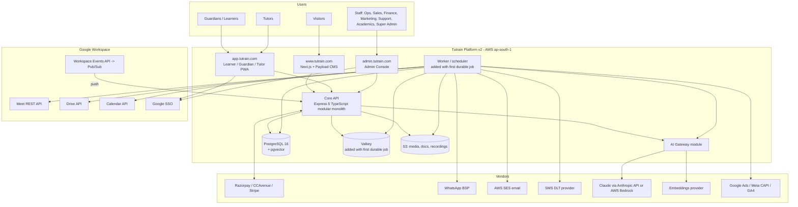
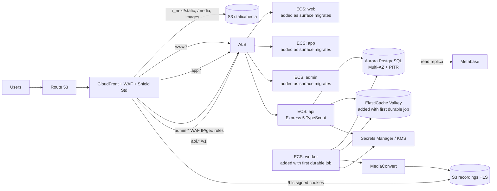
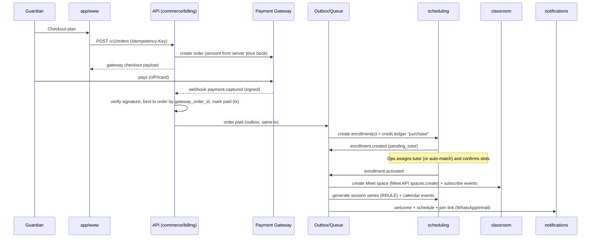
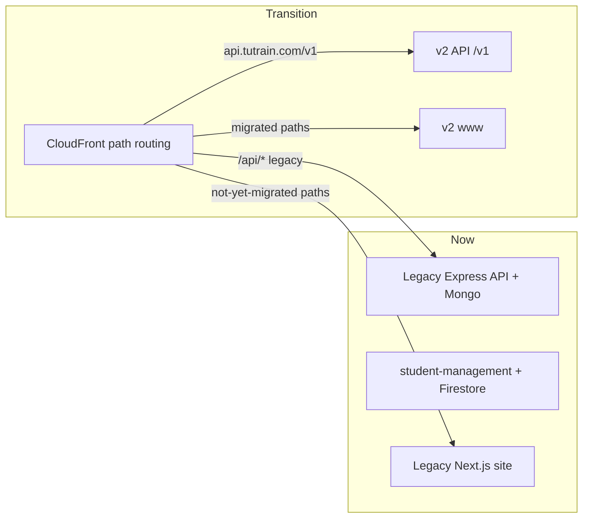

# 03 — Target Architecture

> Companion to [02-SRS.md](./02-SRS.md). This document says **how** the platform is built. The SRS says **what** it must do.

---

## 1. Architecture principles

1. **One system of record.** One PostgreSQL database and one API own every business entity. Firestore and MongoDB are retired.
2. **Modular monolith first.** One deployable API, split internally into domain modules with enforced boundaries. Extract a service only when a module has different scaling, security or release needs (the AI gateway and media pipeline are the likely first candidates).
3. **Events for side effects.** Modules communicate through a transactional outbox → queue. A booking does not call the notification code directly; it emits `session.scheduled`.
4. **Ledgers, not counters.** Money, session credits and tutor earnings are append-only ledgers. Balances are derived values.
5. **Adapters for every vendor.** Payments, messaging, conferencing, LLMs, storage and email sit behind interfaces, so a vendor can be swapped by configuration.
6. **Idempotent everything.** Webhooks, ingestion, jobs and payments carry idempotency keys and can be safely retried.
7. **Server-side truth, static-fast edges.** Marketing pages are statically generated and CDN-cached. Portals are dynamic and authenticated. Nothing private is cached at the edge.
8. **AI through a gateway.** No feature calls an LLM directly. Every call goes through one governed gateway (prompts, guardrails, PII, cost, evals).
9. **Secure by default.** Deny-by-default authorisation, least-privilege IAM, secrets in Secrets Manager, and audit on every privileged write.
10. **Agent-friendly codebase.** Strict TypeScript, generated API clients, conventions in `AGENTS.md`, and specs with acceptance criteria. This makes AI-assisted ("vibe") coding safe.

---

## 2. System context



---

## 3. Technology choices

| Layer | Choice | Why |
|---|---|---|
| Language | **TypeScript (strict)** everywhere | One language across front end, back end and workers. Types catch most of the bugs in the audit. Best results with AI coding agents. |
| Monorepo | **pnpm workspaces**; Turborepo deferred | Shared types, UI and config. Turborepo can be added if a specific need justifies it. |
| API framework | **Express 5 + TypeScript modular monolith**; NestJS deferred | Same framework as the current backend. v2 is a new TypeScript modular monolith in eQOURSE/tutrain; the working Express routes in tutrain-backend stay in service until their area migrates (D-002). |
| Validation | **Zod** schemas shared between API routes and front-end forms | One schema per contract. OpenAPI is generated from it; the generator is selected in TTV2-A03. |
| Database | **PostgreSQL 16 (Amazon RDS / Aurora PostgreSQL)**; approved by D-001 on 2026-11-18 | The domain is relational (orders, ledgers, schedules, RBAC). Needs ACID transactions, exclusion constraints for no-double-booking, row-level security, `pgvector` for AI retrieval, and full-text search. See ADR-002. |
| ORM / migrations | **Drizzle ORM + drizzle-kit** | SQL-first, type-safe, no runtime engine, first-class support for raw SQL (exclusion constraints, RLS, pgvector). |
| Cache / queue | **Valkey + BullMQ**, added with the first durable job | Delayed jobs, retries with backoff, repeatable schedules and rate-limited queues are introduced when a durable job needs them. |
| Events | **Transactional outbox** table → relay, specified in TTV2-A04 | Exactly-once intent per DB transaction. Consumers are idempotent; the worker arrives with the first durable job. |
| Web (public) | Existing frontend remains in service; a Next.js public app is added as its surface migrates | Keeps the current deployment working during migration. |
| CMS | **Payload CMS 3** (runs inside the www Next.js app, Postgres adapter, schema `cms`) | Self-hosted, TypeScript, no per-seat SaaS cost, live preview, drafts/versions, localisation, block-based page builder. See ADR-005. |
| App / Admin UI | Existing frontend remains in service; Next.js apps, **TanStack Query**, **TanStack Table**, **React Hook Form + Zod**, **shadcn/ui (Radix) + Tailwind 4** are added as surfaces migrate | Accessible primitives, fast data UIs, and an incremental migration path. |
| API client | **OpenAPI → generated TS client** (`orval`), plus TanStack Query hooks | Front ends never hand-write fetch calls or response types. |
| Auth | Own auth module: phone/email OTP, magic link, Google OIDC (customers), Google Workspace SSO (staff and tutors); short-lived JWT access + rotating refresh in HttpOnly cookies on `.tutrain.com` | Full control of guardian/learner linking and DPDP consent. No per-MAU vendor lock-in. See ADR-004. |
| Conferencing | **Google Meet** via Meet REST API v2 + Workspace Events API | Already in use. Gives programmatic spaces, attendance, artefacts and events. Kept behind a `ConferencingProvider` interface. |
| Media | **S3 + AWS Elemental MediaConvert (HLS) + CloudFront signed cookies** | Private, adaptive-bitrate playback. Moves recordings out of personal-drive permission problems. |
| Search | Postgres FTS + `pg_trgm` (global admin search). OpenSearch only if needed later. | Avoids running another cluster on day one. |
| AI | Internal **AI Gateway** module. **Claude** models (Anthropic API, or AWS Bedrock for in-region processing). Embeddings provider behind an interface. **pgvector** for retrieval. | See [07-AI-PLATFORM.md](./07-AI-PLATFORM.md). |
| Messaging | WhatsApp BSP (keep AiSensy or move to Gupshup/Interakt), **AWS SES** email, DLT SMS (MSG91), Web Push / FCM | Behind the `NotificationChannel` adapter. |
| Observability | OpenTelemetry → Grafana Cloud or CloudWatch. **Sentry** for errors. Structured logs (pino). | Traces from browser through API and worker to vendor calls. |
| Product analytics | **PostHog** (self-host in-region or EU cloud) + GA4 (marketing) via server-side GTM | Funnels, session replay (masked; disabled on minors' portal pages), feature flags. |
| BI | **Metabase** on a read replica (later: a warehouse) | Department dashboards without engineering effort. |
| Infra as code | **Terraform** (or AWS CDK if the team prefers TS) | Reviewable, reproducible environments. |
| CI/CD | **GitHub Actions** with OIDC to AWS, ECR images, ECS rolling deploys, preview environments per PR for front ends | Consistent with the existing AWS migration plan. |
| Testing | Vitest (unit), Testcontainers Postgres (integration), Playwright (E2E), k6 (load), Pact-style contract tests on the OpenAPI spec | See §11. |

---

## 4. Deployment topology (AWS)

Aligned with `tutrain-frontend/AWS_MIGRATION_PLAN.md` and extended.



| Service | Min/Max tasks (prod) | Notes |
|---|---|---|
| web | added as surface migrates | Existing frontend remains in service until this surface is migrated |
| app | added as surface migrates | Existing frontend remains in service until this surface is migrated |
| admin | added as surface migrates | WAF rule: optional office/VPN IP allowlist + staff SSO |
| api | 2 / 20 | Express 5 TypeScript modular monolith. Webhooks enter here and are queued when the worker exists. |
| worker | added with first durable job | Separate queues with concurrency limits per vendor (Google API quotas, LLM rate limits) |
| scheduler | added with first durable job | Replaces node-cron inside API processes when durable scheduling is required |

Environments: `dev` (shared), `preview-*` (front-end per PR, pointing at staging API), `staging` (production-like, anonymised data), `prod`. Each has its own AWS account (AWS Organizations), database and secrets.

Domains:
- `www.tutrain.com` (apex redirects to www, or the reverse; pick one and keep it)
- `app.tutrain.com`
- `admin.tutrain.com`
- `api.tutrain.com`
- `media.tutrain.com` (CloudFront for HLS and public assets)

Legacy `tutrain.com/api/*` is proxied to the legacy API during migration (§10).

---

## 5. Monorepo layout

```
tutrain/
├─ apps/
│  ├─ web/            # www: marketing, SEO templates, blog, Payload CMS (/cms), chat widget host
│  ├─ app/            # learner / guardian / tutor PWA
│  ├─ admin/          # staff console (department workspaces)
│  ├─ api/            # Express 5 TypeScript modular monolith (HTTP + webhooks)
│  └─ worker/         # added with first durable job; BullMQ consumers + schedulers
├─ packages/
│  ├─ domain/         # domain modules (pure TS services, repositories, events) - used by api & worker
│  │  ├─ iam/  catalog/  crm/  commerce/  billing/  scheduling/  classroom/
│  │  ├─ attendance/  media/  lms/  tutors/  payouts/  support/  notifications/
│  │  ├─ ai/  analytics/  audit/  config/
│  ├─ db/             # Drizzle schema, migrations, seeders, RLS policies
│  ├─ contracts/      # Zod schemas + event types + OpenAPI fragments (single source of truth)
│  ├─ api-client/     # generated OpenAPI client + TanStack Query hooks
│  ├─ ui/             # design system (tokens from design.md, shadcn components, charts)
│  ├─ adapters/       # payments, messaging, google, storage, llm, embeddings implementations
│  ├─ config/         # eslint, tsconfig, tailwind preset, env schema (zod)
│  └─ testing/        # factories, fixtures, testcontainers helpers
├─ infra/             # terraform
├─ docs/              # this documentation set, ADRs, runbooks
├─ AGENTS.md  CLAUDE.md  SPECS.md
└─ pnpm-workspace.yaml
```

`apps/worker`, `apps/web`, `apps/app` and `apps/admin` are added later under D-002 as their first durable job or migrated surface requires them. Turborepo remains deferred unless a specific need justifies it.

Boundary rules (enforced with `eslint-plugin-boundaries`):
- `apps/*` may import `packages/*`, never other apps.
- `packages/domain/<module>` may import its own files, `contracts`, `db` (only its own tables via its repository), `adapters` interfaces, and **other modules' `public.ts` only**.
- Cross-module writes happen **only** through the owning module's service or through events.

---

## 6. Domain modules

| Module | Owns (tables) | Key responsibilities | Emits | Consumes |
|---|---|---|---|---|
| **iam** | users, identities, role_memberships, roles, permissions, sessions, consents | Auth, RBAC + scope, guardian↔learner links, consent ledger | `user.created`, `consent.given/withdrawn` | — |
| **catalog** | taxonomy_nodes, products, price_books, prices, promotions | Curriculum taxonomy, products, pricing, promos | `product.published` | — |
| **crm** | leads, lead_activities, pipelines, tasks, demos, segments, campaigns | Lead lifecycle, assignment, demos, campaigns | `lead.created`, `demo.booked`, `lead.won` | `order.paid`, `chat.lead_captured` |
| **commerce** | carts, orders, order_lines, installments, refunds | Checkout, order state machine, refunds | `order.paid`, `order.refunded` | `payment.succeeded` |
| **billing** | payments, payment_attempts, invoices, credit_notes, ledger_entries, gateway_events | Gateways, webhooks, invoices, GST, reconciliation | `payment.succeeded/failed`, `invoice.issued` | `order.created` |
| **tutors** | tutors, tutor_qualifications, tutor_approvals, availability_rules, availability_exceptions, applications | Recruiting funnel, approvals, availability, matching | `tutor.approved`, `tutor.leave_approved` | — |
| **scheduling** | enrollments, batches, batch_members, session_series, sessions, reschedule_requests, credit_ledger | Enrollments, series generation, reschedules, credits | `enrollment.activated`, `session.scheduled/cancelled/rescheduled`, `session.outcome_set` | `order.paid`, `attendance.computed` |
| **classroom** | meet_spaces, conference_records, participants, participant_sessions, join_tokens | Meet space lifecycle, event intake, raw conference data | `conference.ended`, `artifact.available` | `enrollment.activated` |
| **attendance** | attendance_records, attendance_reviews, unmapped_conferences | Matching, status computation, review, overrides | `attendance.computed`, `attendance.overridden` | `conference.ended` |
| **media** | media_assets, recordings, transcripts, playback_grants | Copy → transcode → serve; transcript storage and chunking | `recording.ready`, `transcript.ready` | `artifact.available` |
| **lms** | curriculum_nodes, learning_plans, session_logs, assignments, submissions, question_bank, tests, attempts, reports, ptms, resources | Learning content, assessment, reports, PTM | `session_log.submitted`, `report.published` | `transcript.ready`, `session.outcome_set` |
| **payouts** | rate_cards, rate_overrides, earning_entries, payout_cycles, payouts | Tutor earnings, payout runs, TDS | `payout.paid` | `session.outcome_set` |
| **support** | tickets, ticket_messages, sla_policies, safeguarding_cases | Ticketing, SLAs, safeguarding | `ticket.created` | `chat.handoff` |
| **notifications** | templates, notification_jobs, deliveries, preferences | Multi-channel delivery, preferences, quiet hours, dedupe | `notification.delivered/failed` | almost every event |
| **ai** | prompts, prompt_versions, ai_calls, kb_documents, kb_chunks (vector), conversations, messages, evals | Gateway, RAG, chatbot orchestration, copilots | `chat.lead_captured`, `chat.handoff` | `product.published`, `cms.page.published`, `transcript.ready` |
| **analytics** | events (partitioned), daily rollups | Event ingest, KPI rollups | — | all |
| **audit** | audit_log (append-only) | Immutable audit trail | — | intercepted writes |
| **config** | settings, feature_flags, policies, holidays, markets | Master configuration | `config.changed` | — |

---

## 7. Key flows

### 7.1 Purchase → enrollment → classes



### 7.2 Class → attendance → earnings
See [06-ATTENDANCE-RECORDING-PIPELINE.md](./06-ATTENDANCE-RECORDING-PIPELINE.md) for the full design. Summary:
`Workspace Events (conference ended)` → Pub/Sub push → `POST /v1/webhooks/google/workspace-events` → enqueue → worker fetches the conference record, participants and sessions → match to the session → compute learner and tutor attendance → set the session outcome → in **one transaction**: credit ledger consume + earning entry + outbox events → notifications and recap.

### 7.3 Chatbot consented demo booking
See [07-AI-PLATFORM.md](./07-AI-PLATFORM.md) §4.

---

## 8. Cross-cutting concerns

### 8.1 Authorisation model
- `permission = <resource>:<action>`, e.g. `session:reschedule`, `finance.payout:approve`, `recording:view`.
- `role_membership = (user, role, scope)`, where scope ∈ `own | assigned | team:<id> | market:<code> | all`.
- Check: `can(user, 'session:read', resource)` → policy functions per resource evaluate ownership (learner/guardian link, tutor assignment, counsellor ownership).
- **Postgres RLS** as defence in depth on the most sensitive tables (payments, payouts, recordings, safeguarding). The API sets `app.user_id` and `app.roles` per transaction.
- **Field-level filtering** for finance fields through response serializers that are permission-aware.
- Default roles: `super_admin`, `ops_manager`, `ops_executive`, `sales_manager`, `counsellor`, `academic_head`, `academic_coordinator`, `qa_auditor`, `marketing_manager`, `content_editor`, `finance_manager`, `finance_executive`, `support_lead`, `support_agent`, `talent_manager`, `safeguarding_officer`, `tutor`, `guardian`, `learner`, `integration`.

### 8.2 Money
- `amount_minor BIGINT` + `currency CHAR(3)`. Never floats. Tax is computed per line with banker's rounding at line level, and invoice totals are the sum of lines.
- Price is always computed server-side from the price book + promotions. The client never sends amounts.
- Every money movement is a `ledger_entries` row (account, direction, amount, reference). Balances are views.

### 8.3 Time
- Store `timestamptz` in UTC. Store the IANA zone on users, tutors and series. Recurrence uses RRULE evaluated in the owner's zone, so DST in UK/US/AU markets stays correct.
- Display times in the viewer's zone, with the other party's zone shown on hover.

### 8.4 Idempotency and consistency
- `Idempotency-Key` header required on POSTs that create orders, payments, bookings or refunds. Stored for 24h with the response hash.
- Webhooks: `gateway_events(provider, event_id) UNIQUE`. Processing is keyed by `(provider, event_id)`.
- Ingestion: keyed by `conference_record_name` and `artifact_name`.
- Jobs: once BullMQ is added, `jobId` is deterministic from the business key.

### 8.5 Configuration and feature flags
- Typed `config` service (DB-backed, cached in Valkey once Valkey is added, invalidated by `config.changed`).
- Feature flags (PostHog or a DB table) for gradual rollout per market, role or percentage.

### 8.6 Files
- Uploads go **directly to S3** via pre-signed POST (size/type limits), then an AV scan (ClamAV Lambda or GuardDuty Malware Protection for S3) → `media_assets` row.
- Private files are served via short-lived signed URLs. Public CMS media via CloudFront with long cache.

---

## 9. Architecture Decision Records (summary)

| ADR | Decision | Alternatives considered | Rationale / consequences |
|---|---|---|---|
| ADR-001 | Express 5 TypeScript modular monolith; dedicated worker added with the first durable job | Microservices; NestJS; keep all work in the legacy app | D-002 keeps Express 5 and builds v2 as a new TypeScript modular monolith in eQOURSE/tutrain; working routes in tutrain-backend are not rewritten just to change frameworks and stay in service until their area migrates. Boundaries are enforced by lint so services can be extracted later; a worker is introduced when durable work requires it. |
| ADR-002 | PostgreSQL replaces MongoDB and Firestore (approved by D-001 on 2026-11-18) | Stay on MongoDB Atlas; stay on Firestore | Money ledgers, orders, RBAC and scheduling are relational. Exclusion constraints prevent double booking. RLS, pgvector and FTS in one engine. Cost: one-time ETL migration (FR-MIG); existing workflows remain live until each domain passes migration, reconciliation and rollback checks. |
| ADR-003 | Google Meet stays, integrated through the Meet REST API + Workspace Events | Zoom; embedded WebRTC (100ms/LiveKit/Daily) | No change to tutor workflow. Official APIs replace audit-log and filename scraping. Behind `ConferencingProvider` so a move to embedded WebRTC (whiteboard, exact attendance, in-app join) is possible in `[P3]`. |
| ADR-004 | In-house auth module (OTP, magic link, Google OIDC, Workspace SSO) | Auth0/Clerk/Cognito/Firebase Auth | Guardian–learner model and DPDP consent are core domain logic. OTP via WhatsApp needs custom flows. Avoids per-MAU fees. Uses vetted libraries (`jose`, `@node-rs/argon2`, `openid-client`). |
| ADR-005 | Payload CMS 3 for marketing content | Sanity, Strapi, Contentful, keep custom CMS controller | Runs inside the Next.js app on our Postgres. TypeScript config. Drafts, versions, live preview and localisation. No SaaS seat cost. |
| ADR-006 | Recordings are copied to S3 and streamed as HLS through CloudFront signed cookies | Stream from Drive through a proxy (student-management approach); share Drive links | Drive proxying is bandwidth-heavy, doesn't support adaptive bitrate, and is subject to Drive quotas. Drive links leak access. S3 gives lifecycle tiers (Glacier) and private CDN delivery. |
| ADR-007 | Build the CRM in-house; integrate WhatsApp/telephony vendors | LeadSquared, HubSpot, Zoho CRM | The CRM is tightly coupled to catalogue, demos, tutor availability, orders and the learner lifecycle. Owning it removes sync jobs and double entry. If Sales prefers a vendor UI, `crm` publishes events that a LeadSquared connector can consume. |
| ADR-008 | AI via an internal gateway; Claude as primary LLM family; pgvector for RAG | Direct SDK calls per feature; managed vector DB | One place for guardrails, PII redaction, cost caps, evals and provider failover. pgvector keeps data in-region and in our backup scope. |
| ADR-009 | BullMQ on Valkey when the first durable job requires it | SQS + EventBridge Scheduler; node-cron | D-002 defers the worker and queue until durable work needs them. When added, rich retry, delay, rate limiting and repeatable jobs in Node give one scheduler; SQS can be added for cross-account fan-out later. |
| ADR-010 | Split public, portal and admin apps as those surfaces migrate | One Next.js app for everything (today) | D-002 keeps the existing frontend running during migration. When split, separate apps can keep the SEO site's JS bundle small, isolate admin attack surface and use shared `packages/ui`. |

Full ADRs go to `docs/adr/NNN-title.md` using the MADR template when the team ratifies them.

---

## 10. Migration strategy (strangler)



1. **Phase 0 (hotfix legacy):** fix the P0 security items in the audit (rotate the leaked service-account key, lock routes, fix payment binding, hash tutor passwords).
2. **Foundation:** stand up the monorepo, infra, IAM, catalogue and DB. Run ETL in **shadow mode** nightly (Mongo + Firestore → Postgres) with reconciliation reports.
3. **Website first:** launch the v2 `www` (CMS, SEO templates, chatbot → v2 CRM). The legacy site serves the dashboards. CloudFront routes by path. The 301 map is verified.
4. **Domain cutovers**, each with a short write freeze, final ETL delta, reconciliation, and a flag flip:
   1. CRM + demos
   2. Catalogue + commerce + billing (new purchases on v2; legacy plans imported as orders + credit ledgers)
   3. Scheduling + classroom + attendance (Meet spaces created for active enrollments; existing codes mapped where possible)
   4. LMS + PTM + tests
   5. Payouts
   6. Support
5. **Portals:** learner/guardian/tutor `app` and the `admin` console go live module by module. Legacy screens are hidden behind a redirect.
6. **Decommission:** legacy stays read-only for 90 days, then is archived (Mongo dump + Firestore export to S3 Glacier).

---

## 11. Quality engineering

| Layer | Tooling | Gate |
|---|---|---|
| Static | `tsc --noEmit` strict, ESLint (boundaries, security), Prettier, `knip` (dead code) | Required |
| Unit | Vitest. Domain services ≥ 80% coverage (money, credits, attendance, scheduling, RBAC) | Required |
| Integration | Vitest + Testcontainers (Postgres, Valkey); adapters mocked with recorded fixtures (Meet API, Razorpay webhooks) | Required |
| Contract | OpenAPI diff check (`oasdiff`). Breaking changes need a version bump | Required |
| E2E | Playwright on preview/staging: the critical journeys in SRS Appendix C | Required on `main` |
| Accessibility | axe-core in Playwright for key pages | Required on www/app |
| Performance | Lighthouse CI budgets on the top templates. k6 load tests before release | Required before release |
| Security | Secret scanning (gitleaks), SCA (Dependabot/Snyk), SAST (CodeQL), container scan (Trivy), DAST (ZAP baseline on staging) | Required |
| AI | Eval suites per prompt (golden sets, rubric grading, red-team prompts) | Required when prompts change |

---

## 12. Non-goals and future options
- Native apps (Expo/React Native sharing `contracts` and `api-client`): `[P3]`.
- Embedded classroom (LiveKit/100ms with a whiteboard): `[P3]`, behind `ConferencingProvider`.
- Data warehouse (BigQuery/Redshift/ClickHouse) and reverse-ETL: when Metabase on a replica stops being enough.
- Public partner API / MCP server for B2B and internal agents: `[P3]` (see [07](./07-AI-PLATFORM.md) §8).
