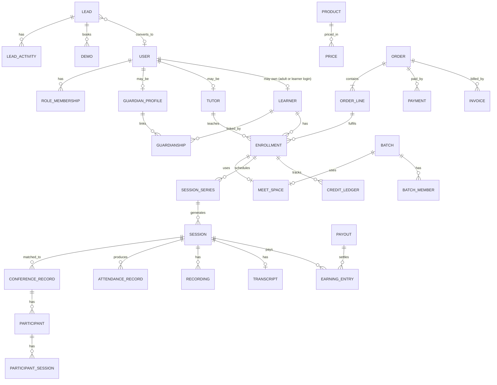

# 04 — Logical Data Model (PostgreSQL)

> Conventions:
> - `id UUID v7` primary keys (time-sortable).
> - Every table has `created_at`, `updated_at timestamptz` and `created_by`, `updated_by uuid NULL`.
> - snake_case. One Postgres schema per module (`iam.*`, `crm.*`, …).
> - Money is `*_minor BIGINT` + `currency CHAR(3)`.
> - Soft delete (`deleted_at`) only where noted.
>
> This is the logical model for the first implementation. The Drizzle schema in `packages/db` is the source of truth once it exists.

---

## 1. Entity overview



---

## 2. IAM (`iam`)

| Table | Key columns | Notes |
|---|---|---|
| `users` | id, primary_phone_e164 UNIQUE NULL, primary_email CITEXT UNIQUE NULL, display_name, locale, time_zone, status(`active,suspended,deleted`), last_login_at | One identity per human |
| `identities` | user_id, provider(`phone_otp,email_otp,google,workspace_sso,password`), provider_subject, verified_at | UNIQUE(provider, provider_subject) |
| `password_credentials` | user_id PK, hash (argon2id), updated_at | Optional |
| `auth_sessions` | id, user_id, refresh_token_hash, device, ip_hash, ua, expires_at, revoked_at, rotated_from | Refresh rotation with reuse detection |
| `otp_challenges` | id, channel, destination_hash, code_hash, purpose, attempts, expires_at, consumed_at | Rate-limited; TTL purge |
| `roles` | id, key UNIQUE, name, description, is_system | |
| `permissions` | key PK (`session:reschedule`), module, description | Seeded from code |
| `role_permissions` | role_id, permission_key | |
| `role_memberships` | user_id, role_id, scope_type(`own,assigned,team,market,all`), scope_ref | |
| `teams` | id, name, department | Sales pods, ops shifts |
| `guardian_profiles` | user_id PK, relationship_default, billing_address jsonb, gstin NULL | |
| `learners` | id, user_id NULL (own login), full_name, dob NULL, grade_node_id, board_node_id, school, time_zone, status | A learner can exist without a login |
| `guardianships` | guardian_user_id, learner_id, relationship, is_primary, can_pay, can_view_recordings | UNIQUE(guardian_user_id, learner_id) |
| `consents` | id, subject_user_id NULL, subject_phone_hash NULL, learner_id NULL, purpose(`demo_booking,marketing_whatsapp,marketing_email,recording,ai_processing,analytics`), status(`given,withdrawn`), notice_version, channel(`web_form,chatbot,whatsapp,portal,call`), evidence jsonb (ip_hash, ua, message_id, otp_challenge_id), given_at, withdrawn_at | Append-only consent ledger (DPDP) |

## 3. Config and catalogue (`config`, `catalog`)

| Table | Key columns | Notes |
|---|---|---|
| `markets` | code PK (`IN`,`AE`,`GB`,`US`…), currency, default_tz, tax_profile, payment_providers jsonb, is_active | |
| `taxonomy_nodes` | id, type(`category,board,grade,subject,exam,language,level,skill`), parent_id, slug, name, sort, is_active, meta jsonb | Replaces the hard-coded enums and the `config` collection |
| `products` | id, sku, name, kind(`package,session_pack,subscription,custom,batch,addon,demo`), taxonomy refs (category/board/grade/subjects[]/exam/language_level), sessions_total, session_minutes, ptm_count, tests_count, features jsonb, visibility(`public,hidden,counsellor_only`), status | |
| `product_subject_allocations` | product_id, subject_node_id, sessions | Replaces `session_distribution` |
| `price_books` / `prices` | price_book(market, valid_from, valid_to); price(product_id, list_minor, sale_minor, per_session_minor, tax_inclusive) | |
| `batch_slabs` | product_id NULL, min_learners, max_learners, discount_bps | |
| `promotions` | id, code CITEXT NULL UNIQUE, type(`percent,amount,free_sessions`), value, max_redemptions, per_user_limit, eligibility jsonb, starts_at, ends_at, requires_approval | |
| `promotion_redemptions` | promotion_id, user_id, order_id | UNIQUE(promotion_id, order_id) |
| `policies` | key (`reschedule`,`cancellation`,`refund`,`attendance_thresholds`), version, body jsonb, effective_from | Versioned. Orders and enrollments store the policy version they were sold under |
| `settings`, `feature_flags`, `holiday_calendars` | | |

## 4. CRM (`crm`)

| Table | Key columns |
|---|---|
| `leads` | id, phone_e164, email, name, guardian_name, learner_grade_node_id, board_node_id, subjects[], market, city, source, utm jsonb, click_ids jsonb, first_touch_at, last_touch_at, stage, owner_user_id, score, lost_reason, converted_user_id, dedupe_key UNIQUE |
| `lead_activities` | id, lead_id, type(`call,whatsapp,email,note,stage_change,chat,demo,task`), direction, body, meta jsonb, actor_user_id, occurred_at |
| `tasks` | id, entity_type, entity_id, assignee_id, due_at, status, title |
| `pipelines`, `pipeline_stages` | configurable stages, required fields, SLA minutes |
| `demos` | id, lead_id, learner_id NULL, tutor_id, subject_node_id, scheduled_start, scheduled_end, meet_space_id, status, booked_via(`web,chatbot,whatsapp,counsellor`), consent_id, feedback jsonb (level, gaps, recommended_product_id), outcome |
| `segments`, `campaigns`, `campaign_sends`, `journeys`, `journey_enrollments` | marketing automation |

## 5. Commerce and billing (`commerce`, `billing`)

| Table | Key columns | Notes |
|---|---|---|
| `orders` | id, number UNIQUE, account_user_id, market, currency, status, subtotal_minor, discount_minor, tax_minor, total_minor, paid_minor, policy_versions jsonb, source(`web,counsellor,renewal,batch,admin`), counsellor_id | |
| `order_lines` | id, order_id, product_id, learner_id, quantity, unit_minor, discount_minor, tax_minor, total_minor, config jsonb (custom allocations, preferred days/time) | |
| `installments` | id, order_id, due_date, amount_minor, status | |
| `payments` | id, order_id, provider, provider_order_id UNIQUE, provider_payment_id UNIQUE NULL, amount_minor, currency, method, status(`created,authorized,captured,failed,refunded,partially_refunded`), captured_at, raw jsonb | **Binding rule:** a webhook can only update the payment whose `provider_order_id` matches |
| `gateway_events` | id, provider, event_id, type, payload jsonb, received_at, processed_at, error | UNIQUE(provider, event_id) |
| `refunds` | id, order_id, payment_id, amount_minor, reason, status, approved_by, provider_refund_id | |
| `invoices` | id, series, number, fy, order_id, legal_entity, buyer jsonb, place_of_supply, lines jsonb, cgst/sgst/igst_minor, total_minor, pdf_key, status | UNIQUE(series, fy, number) |
| `credit_notes` | same shape, references invoice | |
| `ledger_entries` | id, account(`receivable,cash_gateway,revenue_deferred,revenue_recognised,refunds,tutor_payable,tds_payable,discounts`), direction(`dr,cr`), amount_minor, currency, ref_type, ref_id, occurred_at, memo | Append-only. Each business event writes a balanced pair/set |

## 6. Tutors and payouts (`tutors`, `payouts`)

| Table | Key columns |
|---|---|
| `tutors` | id, user_id UNIQUE, workspace_email UNIQUE, status(`applicant,onboarding,active,on_leave,suspended,offboarded`), bio, methodology, intro_video_asset_id, languages[], time_zone, public_profile bool, quality_score, verification jsonb |
| `tutor_approvals` | tutor_id, subject_node_id, board_node_id NULL, grade_node_id NULL, level NULL, approved_by, approved_at |
| `tutor_applications` | id, applicant fields, stage, test_score, interview_score, rubric jsonb, documents[] |
| `availability_rules` | tutor_id, weekday, start_local, end_local, valid_from, valid_to |
| `availability_exceptions` | tutor_id, starts_at, ends_at, kind(`leave,extra`) |
| `payout_accounts` | tutor_id, method, encrypted_details (app-level KMS envelope), pan_last4, verified_at |
| `rate_cards` | id, kind(`academic,language,skill`), grade_node_id, board_group(`cbse_state,icse,ib,igcse_other`), level, per_session_minor, effective_from |
| `rate_overrides` | id, scope(`tutor`,`enrollment`), tutor_id, enrollment_id NULL, match jsonb (grade/board/level), per_session_minor, note, effective_from |
| `earning_entries` | id, tutor_id, session_id UNIQUE NULL, kind(`session,demo,bonus,penalty,adjustment`), amount_minor, rate_source, payout_id NULL, status |
| `payout_cycles`, `payouts` | cycle(period), payout(tutor_id, gross_minor, tds_minor, net_minor, status, statement_pdf_key, utr) |

## 7. Scheduling and classroom (`scheduling`, `classroom`)

```sql
CREATE TABLE scheduling.enrollments (
  id uuid PRIMARY KEY,
  learner_id uuid NOT NULL REFERENCES iam.learners(id),
  order_line_id uuid REFERENCES commerce.order_lines(id),
  product_id uuid NOT NULL,
  subject_node_id uuid NOT NULL,
  tutor_id uuid REFERENCES tutors.tutors(id),
  batch_id uuid NULL,
  status text NOT NULL,  -- pending_tutor|pending_schedule|active|paused|completed|cancelled|transferred
  session_minutes int NOT NULL,
  attendance_policy jsonb NOT NULL,  -- {present_pct:75, partial_floor_pct:25}
  policy_versions jsonb NOT NULL,
  starts_on date, ends_on date
);

CREATE TABLE scheduling.sessions (
  id uuid PRIMARY KEY,
  series_id uuid NULL,
  enrollment_id uuid NULL,      -- 1:1
  batch_id uuid NULL,           -- group
  demo_id uuid NULL,            -- demo
  tutor_id uuid NOT NULL,
  meet_space_id uuid NOT NULL,
  scheduled tstzrange NOT NULL, -- [start, end)
  status text NOT NULL,         -- scheduled|live|ended|cancelled_*|rescheduled
  outcome text NULL,            -- conducted|learner_no_show|tutor_no_show|technical_issue|partial_review
  outcome_source text NULL,     -- auto|override
  rescheduled_from uuid NULL,
  topic_plan jsonb NULL,
  CHECK (num_nonnulls(enrollment_id, batch_id, demo_id) = 1)
);

-- A tutor can never be double-booked (cancelled/rescheduled rows excluded)
CREATE EXTENSION IF NOT EXISTS btree_gist;
ALTER TABLE scheduling.sessions ADD CONSTRAINT no_tutor_overlap
  EXCLUDE USING gist (tutor_id WITH =, scheduled WITH &&)
  WHERE (status IN ('scheduled','live','ended'));
```

| Table | Key columns | Notes |
|---|---|---|
| `batches`, `batch_members` | batch(product, tutor, subject, capacity, status); member(batch_id, learner_id, order_line_id, joined_at, left_at) | |
| `session_series` | id, enrollment_id/batch_id, rrule, time_zone, starts_on, until, slot_minutes | |
| `reschedule_requests` | session_id, requested_by, reason, proposed tstzrange, policy_eval jsonb, status, decided_by | |
| `credit_ledger` | id, enrollment_id, delta INT, reason(`purchase,consume,forfeit_no_show,late_cancel,compensate,transfer_in,transfer_out,expire,admin_adjust`), session_id NULL, order_line_id NULL, actor, note | `balance = SUM(delta)`. UNIQUE(session_id, reason) WHERE session_id IS NOT NULL, so a session is never charged twice |
| `classroom.meet_spaces` | id, provider(`google_meet`), space_name (`spaces/…`) UNIQUE, meeting_code UNIQUE, meeting_uri, owner_workspace_user, access_type, owner_ref_type(`enrollment,batch,demo_pool`), owner_ref_id, events_subscription_name, subscription_expires_at, status | One stable space per enrollment/batch. Demo spaces come from a pool or are created per demo |
| `classroom.join_tokens` | id, session_id, learner_id, token_hash, used_at, ip_hash, ua | Platform "Join" click: corroboration evidence + batch identity |
| `classroom.conference_records` | id, provider_name (`conferenceRecords/…`) UNIQUE, meet_space_id, start_time, end_time, session_id NULL, match_status(`matched,unmapped,ambiguous,ignored`), fetched_at | |
| `classroom.participants` | id, conference_record_id, provider_name UNIQUE, kind(`signed_in,anonymous,phone`), google_user_id NULL, email NULL, display_name, resolved_role(`tutor,learner,staff,guest,unknown`), learner_id NULL, tutor_id NULL | |
| `classroom.participant_sessions` | participant_id, provider_name UNIQUE, start_time, end_time | Each join/leave segment |

## 8. Attendance and media (`attendance`, `media`)

| Table | Key columns | Notes |
|---|---|---|
| `attendance_records` | id, session_id, subject_type(`learner,tutor`), learner_id NULL, tutor_id NULL, minutes_attended, first_join, last_leave, late_minutes, segments jsonb, computed_status(`present,partial,absent,no_data`), final_status, status_source(`auto,override`), override_reason, overridden_by, policy_snapshot jsonb, computed_at | UNIQUE(session_id, subject_type, coalesce(learner_id,tutor_id)). Re-ingestion updates `computed_*` only and never touches `final_status` when `status_source='override'` |
| `attendance_reviews` | id, attendance_record_id, reason(`partial,unmatched_participant,dispute,no_data`), status, assignee, resolution | |
| `unmapped_conferences` | id, conference_record_id UNIQUE, meeting_code, reason, status(`open,mapped,dismissed`) | |
| `media_assets` | id, kind, s3_key, bytes, mime, sha256, av_status, visibility | |
| `recordings` | id, session_id, provider_artifact_name UNIQUE, drive_file_id, source_state, s3_master_key, hls_prefix, duration_s, status(`pending_copy,copying,transcoding,ready,failed,archived,deleted`), retention_until | |
| `transcripts` | id, session_id, provider_artifact_name UNIQUE, docs_file_id, text_s3_key, entries_count, language, status | |
| `transcript_chunks` | id, transcript_id, seq, start_ms, end_ms, speaker_role, text, embedding vector(1024) | For RAG over own classes |
| `playback_grants` | id, recording_id, user_id, granted_at, expires_at, ip_hash | Every view logged |

## 9. LMS (`lms`)

| Table | Key columns |
|---|---|
| `curriculum_nodes` | id, taxonomy root (board/grade/subject), parent_id, type(`unit,chapter,topic`), title, objectives[], academic_year, order |
| `learning_plans`, `learning_plan_items` | per enrollment: ordered curriculum_node_ids, planned session index, status(`planned,in_progress,covered,revisit`) |
| `session_logs` | session_id UNIQUE, covered_node_ids[], homework_text, observations, engagement(1-5), ai_draft jsonb, submitted_by, submitted_at |
| `session_recaps` | session_id UNIQUE, summary_md, key_points[], homework, status(`draft,approved,sent`), approved_by |
| `assignments`, `submissions` | assignment(enrollment/batch, title, body, attachments, due_at, max_score); submission(files, text, score, feedback, graded_by) |
| `questions` | id, curriculum_node_id, type(`mcq,msq,numeric,short,long,file`), body jsonb, answer jsonb, difficulty, source(`manual,ai`), reviewed_by |
| `tests`, `test_items`, `test_attempts`, `attempt_answers` | timed tests, auto + AI-assisted grading with tutor confirmation |
| `progress_reports` | learner_id, enrollment_id, period, metrics jsonb, narrative_md, status, pdf_key |
| `ptms` | id, enrollment_id, scheduled tstzrange, meet_space_id, agenda, notes, action_items jsonb, status |
| `resources` | id, title, asset_id, curriculum_node_ids[], visibility(`public,enrolled,tutor_only`), status(`pending,approved,rejected`), uploaded_by |

## 10. Support, notifications, AI, audit

| Table | Key columns |
|---|---|
| `support.tickets` | id, number, requester_user_id NULL, contact jsonb, category, priority, status, assignee_id, sla_due_at, links jsonb (learner/session/order), channel, csat |
| `support.ticket_messages` | ticket_id, author, body, internal bool, attachments |
| `support.safeguarding_cases` | restricted RLS; reporter, subject, description, severity, status, officer_id |
| `notify.templates` | key, channel, locale, provider_template_id, body, variables[], category(`transactional,marketing,otp`) |
| `notify.jobs` / `deliveries` | dedupe_key UNIQUE, recipient, channel, template_key, payload, status, provider_message_id, error |
| `notify.preferences` | user_id, category, channel, enabled, quiet_hours |
| `ai.prompts` / `prompt_versions` | key, version, model, params, system_text, tools jsonb, eval_suite, status |
| `ai.calls` | id, feature, prompt_version_id, model, input_tokens, output_tokens, cost_micro_usd, latency_ms, user_id NULL, conversation_id NULL, guardrail_flags jsonb, error |
| `ai.kb_documents` / `kb_chunks` | source(`cms,catalog,faq,policy,tutor_profile,blog`), source_id, version, url, chunk text, embedding vector(1024), published bool |
| `ai.conversations` / `messages` | channel, anon_id/user_id, lead_id, outcome, handoff_ticket_id; message(role, content, tool_calls jsonb) |
| `audit.audit_log` | id BIGSERIAL, at, actor_user_id, actor_type, action, entity_type, entity_id, before jsonb, after jsonb, ip_hash, request_id. **Append-only:** `REVOKE UPDATE, DELETE`. Monthly partitions |
| `app.outbox` | id, topic, key, payload jsonb, created_at, published_at NULL |
| `analytics.events` | partitioned by day; name, anon_id, user_id, props jsonb, ts |

---

## 11. Invariants (enforced in code and/or the database)

1. A tutor has no overlapping active sessions (exclusion constraint).
2. A learner has no overlapping active sessions (service check plus an exclusion constraint on `session_learners` for batches).
3. A session consumes **at most one** credit per enrollment (`UNIQUE(session_id, reason)` on `credit_ledger`).
4. A session produces **at most one** `session`-kind earning entry (`UNIQUE(session_id)` where kind='session').
5. A payment can only be marked captured by a gateway event or a status fetch whose `provider_order_id` equals the payment's (`payments.provider_order_id` UNIQUE + lookup by it).
6. `ledger_entries` per business event net to zero across dr/cr.
7. An admin attendance override is never overwritten by automation.
8. `audit_log` and `consents` cannot be updated or deleted by the application role.

---

## 12. Legacy → v2 mapping (migration)

| Legacy source | v2 target | Notes |
|---|---|---|
| Mongo `student` (+ `parent_name`) | `users` (guardian/account holder), `learners`, `guardianships` | Phone/email → identities; split parent and learner when `parent_name` is present |
| Mongo `student.plan[]` | `orders` + `order_lines` + `payments` (from `transaction`) + `enrollments` (per assigned_tutor subject) + `credit_ledger` (purchase = total_sessions, consume = completed sessions, adjust to match `remaining_sessions`) | Reconcile per plan: `sum(delta) == remaining_sessions` |
| Mongo `plan.tutor_salary_overrides`, `tutor.salary_overrides`, `tutor_salary` | `rate_overrides(enrollment)`, `rate_overrides(tutor)`, `rate_cards` | |
| Mongo `session` | `sessions` (+ `reschedule_requests`) | `google_event_id` (meeting code) → `meet_spaces` (legacy, unmanaged) |
| Mongo `attendance` + Firestore `class_sessions` / `attendance_raw` | `attendance_records`, `conference_records` (legacy import flag) | Firestore wins for attendance minutes; Mongo wins for session identity; conflicts listed |
| Firestore `enrollments` / `meetingCodeIndex` | `enrollments` ↔ `meet_spaces` | Critical mapping; validated against Mongo assignments |
| Firestore `fees`, `payments`, `salaries` | `installments` / `payments` (source=manual) / `payouts` | Paise already integer |
| Mongo `batch_registration` | `batches`, `batch_members`, `orders` | |
| Mongo `demo_session_request`, `query`, `notify`, newsletter, Firestore `leads` | `leads`, `demos`, `lead_activities`, `consents` (legacy, evidence=`imported`) | Dedupe by phone |
| Mongo `ticket` | `support.tickets` | |
| Mongo `page`, `review`, `rating`, `video`, `ebook` | Payload CMS collections | Slugs preserved |
| Mongo `admin`, `Role` | `users` + `role_memberships` (mapped to new role keys) | Staff move to Workspace SSO |
| Mongo `logs_activity`, Firestore `audit_log` | `audit.audit_log` (legacy flag) | |
