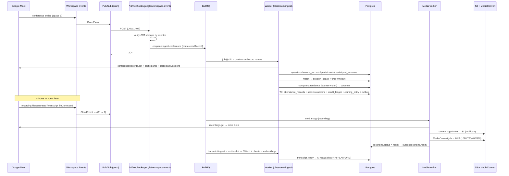

# 06 — Attendance, Recording and Transcript Pipeline (v2)

> Replaces both `tutrain-backend/services/meetSyncService.js` and `student-management/functions/src/ingest.ts`.
> Keeps the good ideas from student-management: a permanent meeting code per enrollment, an idempotent session key, an unmapped queue, and override preservation. Fixes defects A1–A9 from [01-CURRENT-STATE-AUDIT.md](./01-CURRENT-STATE-AUDIT.md).

---

## 1. Goals
1. **Correct.** The right learner, the right session, the right minutes. Never guess by name.
2. **Event-driven and fast.** Attendance ≤ 15 min after a class ends. Recording playable ≤ 2 h after Google generates it.
3. **Self-healing.** Late artefacts, retries, outages and newly mapped codes are all handled automatically.
4. **Private.** Recordings never leave Tutrain control. They are streamed only to authorised viewers.
5. **One source of truth.** One pipeline writes into one database. Outcomes drive credits and tutor earnings atomically.

## 2. Google APIs used

| API | Use |
|---|---|
| **Meet REST API v2** `spaces.create` / `spaces.get` / `spaces.patch` | Create one persistent space per enrollment/batch. Read the meeting code and URI. Set the access type (e.g. `TRUSTED`) and turn on auto-recording/transcription where the Workspace edition supports it. |
| **Meet REST API v2** `conferenceRecords.list` (filter by `space.name` / `space.meeting_code` and `start_time`), `conferenceRecords.get` | Find the actual calls held in a space |
| `conferenceRecords.participants.list` / `participantSessions.list` | Who joined (signed-in user / anonymous / phone) and each join–leave segment |
| `conferenceRecords.recordings.list` | Recording artefact → Drive file ID (`driveDestination.file`) and state |
| `conferenceRecords.transcripts.list` / `transcripts.entries.list` | Transcript artefact → Docs file ID, plus structured entries (participant, text, start/end time) |
| **Workspace Events API** `subscriptions.create` on the Meet space (target: Cloud Pub/Sub topic) | Events: `google.workspace.meet.conference.v2.started`, `...conference.v2.ended`, `...participant.v2.joined/left`, `...recording.v2.fileGenerated`, `...transcript.v2.fileGenerated` |
| **Drive API** `files.get(alt=media)` | Download the recording MP4 (impersonating the space owner / host account) |
| **Admin SDK Directory / People API** | Resolve `users/{id}` of signed-in participants to an email |

> Before Phase 2 build, verify with a spike on the Tutrain Workspace tenant: the Workspace edition, recording/transcript availability, event-subscription lifetimes and renewal, and API quotas. Assumption AS1 in the SRS. Section 9 has the fallback.

Authentication: a dedicated GCP project, a service account with **domain-wide delegation** for the minimal scopes (`meetings.space.created`, `meetings.space.readonly`, `drive.readonly`, `admin.directory.user.readonly`), impersonating the space owner. Keys live only in AWS Secrets Manager. Prefer AWS → GCP **workload identity federation** over key files.

## 3. Space ownership model

| Owner | Space | Who hosts |
|---|---|---|
| 1:1 enrollment | 1 persistent space per enrollment, created at `enrollment.activated` | Space owned by a Tutrain host account (e.g. `classes@` pool or the tutor's Workspace account). The tutor is a co-host. |
| Batch | 1 persistent space per batch | Same |
| Demo | A space per demo (or a pool of demo spaces checked out per slot) | Same |
| PTM | A space per PTM, or reuse the enrollment space in a different time window | Same |

Benefits:
- The meeting code is **stable and unique per enrollment/batch**. Same as the student-management idea, but created by the system instead of pasted by an admin.
- If a tutor changes, re-host the same space (keep the code), or create a new space and notify everyone. Either way, `meet_spaces.owner_ref` stays authoritative.
- Spaces are owned by Tutrain, so artefacts land in Drive accounts the pipeline can read.

The join link is never shown raw. The portal "Join class" button goes through `GET /v1/sessions/{id}/join`, which:
1. checks the caller is allowed and the session is within its join window (T−15 min to end),
2. records a `join_token` (time, user, IP hash, UA) as corroborating evidence, and
3. redirects to the Meet URI.

This also tells us **which learner** clicked in a batch.

## 4. Pipeline



### 4.1 Reconciliation (safety net)
A scheduled job every 15 min (single scheduler) runs `reconcile.window`:
- For every session whose scheduled end was 20 min to 72 h ago with `outcome IS NULL`: call `conferenceRecords.list` filtered by the space and the time window, then enqueue `ingest.conference` for any conference record not already processed. (Covers missed events and expired subscriptions.)
- For every conducted session with no recording/transcript after 6 h: call `recordings.list` / `transcripts.list` and enqueue copies.
- For every unmapped conference whose space is now mapped: re-enqueue.
- Renew Workspace Events subscriptions that expire within 24 h.

There is **no watermark.** Work is selected from the database by state, so a single failure can never hide other items (fixes A7).

### 4.2 Matching a conference to a session
```
candidates = sessions WHERE meet_space_id = space.id
             AND status IN ('scheduled','live','ended')
             AND scheduled && tstzrange(conf.start - 30min, conf.end + 60min)
```
- 0 candidates → `unmapped_conferences(reason='no_session_in_window')`. Covers extra classes held without a schedule; ops can "attach to new ad-hoc session".
- 1 candidate → match.
- More than 1 (e.g. back-to-back sessions in the same space) → choose the session with the largest overlap. If the overlap ratio is under 0.5 → `ambiguous` review.
- Several conference records for one session (tutor ended the call and restarted it) → **all are attached to the session** and participant segments are merged across them. This replaces the rejoin handling done through multiple XLSX files.
- A space not known to `meet_spaces` (legacy pasted link) → `unmapped_conferences(reason='unknown_space')`. Mapping the space reprocesses it (fixes A9 by having one queue).

### 4.3 Identifying participants

| Participant kind | Resolution order |
|---|---|
| Signed-in, Workspace domain | Email → the tutor assigned to the session = **tutor**. Another Tutrain staff account = **staff** (observer, QA). |
| Signed-in, consumer Google account | Email → `identities(provider='google')` → learner via guardianship / learner login → **learner** |
| Anonymous / phone | **1:1 sessions:** any non-tutor, non-staff human = the enrolled learner (same rule as student-management, now explicit and limited to 1:1). **Batch:** match `join_tokens` for this session by time proximity (token used within ±2 min of the participant's first segment start) and display-name similarity. A unique, high-confidence match gets assigned; anything else → review queue. |

**Never** match by first name across the whole student base (fixes A1).

To raise identity quality for batches, the portal asks learners to "Sign in with Google" once and links that Google identity to their learner profile. Meet then reports them as signed-in users.

### 4.4 Computing attendance
Inputs: participant segments (merged and de-overlapped per person), scheduled window `[S, E)`, and `attendance_policy` from the enrollment/product (defaults below; configurable in Admin → Policies).

```
effective_window = [S - 10min, E + 15min]          # grace before/after
minutes = |union(segments) ∩ effective_window|      # de-duplicated overlap
pct     = minutes / scheduled_minutes
learner.computed_status =
   present  if pct >= present_pct        (default 0.75)
   partial  if pct >= partial_floor_pct  (default 0.25)   → review queue
   absent   otherwise
tutor.late_minutes  = max(0, first_join - S)
tutor.computed_status =
   present  if pct >= tutor_present_pct  (default 0.90) and late_minutes <= 10
   late     if pct >= tutor_present_pct and late_minutes > 10
   partial  if pct >= 0.25
   absent   otherwise
```
This replaces the fixed 45 minutes (fixes A2).

### 4.5 Session outcome rules (defaults, policy-configurable)

| Tutor | Learner(s) | Outcome | Credit | Tutor earning |
|---|---|---|---|---|
| present/late | present | `conducted` | consume 1 | full (late → configurable penalty) |
| present/late | partial | `partial_review` → ops decides `conducted` or `learner_no_show` | after review | after review |
| present (waited ≥ 15 min) | absent | `learner_no_show` | consume 1 (forfeit) per policy | no-show rate (e.g. 50%, configurable) |
| absent | any | `tutor_no_show` | none. Auto-create a make-up request | none. Penalty per policy |
| no conference at all by E+60 min | — | `no_data` → reconcile until E+72 h, then ops review (never auto "missed"; fixes A8) | none until resolved | none until resolved |
| batch | per learner | session `conducted` if the tutor is present. Per-learner attendance recorded. Credits per learner by their own status | per learner | one earning (batch rate) |

All of the above are written in **one DB transaction** together with the outbox events `session.outcome_set` and `attendance.computed`. Unique keys prevent double consumption or double earning, even if the job runs twice.

### 4.6 Overrides and review
- The review queue in Admin → Operations → Attendance Review lists `partial`, `ambiguous`, unmatched participants, `no_data` and disputes, with evidence: segments timeline, join-token clicks, recording link and transcript snippet.
- Overrides set `final_status`, `status_source='override'` and `override_reason`, and are audit-logged. Re-ingestion updates only the `computed_*` fields. If the new computed value differs from an override, it raises an informational flag and never overwrites the override.
- Changing an outcome after payout lock creates **adjusting** ledger entries (credit compensate, earning adjustment). History is never rewritten.

## 5. Recordings

| Step | Detail |
|---|---|
| Trigger | `recording.fileGenerated` event, or reconciliation |
| Copy | Worker impersonates the file owner, streams Drive `alt=media` → S3 multipart (`recordings/raw/{yyyy}/{mm}/{session_id}/{artifact}.mp4`), records the SHA-256 |
| Transcode | MediaConvert → HLS ladder 1080p/720p/480p/360p + thumbnails → `recordings/hls/{session_id}/` |
| Serve | `GET /v1/recordings/{id}/playback` → authorisation check (learner/guardian/tutor of the session, or `recording:view`) → issues **CloudFront signed cookies** scoped to the HLS prefix for 2 h → logs `playback_grants`. The player is hls.js inside the app, with a visible watermark overlay (viewer name + time) to discourage screen-recording leaks. |
| Drive copy | After a verified S3 copy plus a 7-day grace period, optionally move the Drive original to an archive shared drive or delete it (configurable), to control Workspace storage |
| Lifecycle | S3 Standard 30 d → Standard-IA → Glacier Instant Retrieval at 180 d → delete at retention end (SRS §7). Retention holds for disputes/safeguarding. |
| Failure | Retries with backoff. Status `failed` alerts ops. A manual "retry copy" button. |

Fixes A4/A5: no Drive name search; artefacts come by ID from the conference record. No Drive links are ever exposed.

## 6. Transcripts
1. `transcript.fileGenerated` → `transcripts.entries.list` (structured, with participant attribution and timestamps). Use the Docs export only as a fallback.
2. Store the full text in S3 (`transcripts/{session_id}.jsonl`). Map speaker → role (tutor/learner) using participants.
3. Chunk (≈ 400 tokens, aligned to entries, with start/end ms), embed via the AI gateway, store in `transcript_chunks` (pgvector).
4. Emit `transcript.ready` → AI jobs ([07](./07-AI-PLATFORM.md) §6):
   - session recap draft,
   - session-log pre-fill (topics covered mapped to curriculum nodes),
   - homework suggestions,
   - quiz suggestions,
   - quality/safety signals (talk-time ratio, learner engagement, flagged language or contact-sharing attempts).
5. Transcripts are visible to the session tutor, the session's learner/guardian (configurable) and staff with `transcript:view`.

## 7. Observability and alerts

| Metric | Alert |
|---|---|
| `events_received` vs sessions ended (per hour) | ratio < 0.8 for 2 h (subscription broken) |
| `ingest_lag_seconds` p95 (conference end → attendance computed) | > 15 min |
| `unmapped_open`, `review_open` backlog | > 20 or oldest > 24 h |
| `recording_ready_lag` p95 | > 2 h |
| `recording_failed` count | > 0 |
| Subscription expiry horizon | < 12 h |
| Google API 429/5xx rate | > 5% for 10 min |

The ops dashboard "Pipeline Health" shows all of the above. Runbooks live in `docs/runbooks/attendance-pipeline.md`.

## 8. Testing strategy
- Recorded fixtures of real Meet API responses (anonymised) for: a normal 1:1 class, a rejoin with 3 segments, a tutor restart (2 conference records), a learner no-show, a tutor late by 12 min, a batch with 1 anonymous participant, a back-to-back sessions ambiguity, a late recording (6 h), and an unknown space.
- Property tests for interval union/intersection and the threshold computation.
- An idempotency test: process the same conference 3× → identical DB state, a single credit, a single earning.
- An override-preservation test.
- A chaos test: drop every event for a day → reconciliation alone produces the same results.

## 9. Fallback mode (if Meet REST API / Events are unavailable on the Workspace edition)
Use the student-management Drive-folder ingestion, with these fixes applied:
1. Select work by **state** (files not yet in `ingested_files(file_id)`), not by watermark (fixes A7).
2. Parse the attendance XLSX → participant segments → **the same matching and computation code** (sections 4.2–4.6), so the rules are identical.
3. Resolve the space by meeting code from the filename → `meet_spaces.meeting_code`.
4. Recordings found by `(code, date)` filename → the same copy/transcode path (section 5).

The pipeline is written behind a `ConferenceSource` interface (`MeetApiSource`, `DriveReportSource`) so switching sources is configuration only.

## 10. Migration of existing data
- Import Firestore `class_sessions` + `attendance_raw` and Mongo `attendance` as `conference_records(source='legacy')` + `attendance_records(status_source='legacy')`. Mark them frozen (no recomputation).
- Import `enrollments.meetingCode` → `meet_spaces(managed=false)`. Active enrollments get a **new managed space** at cutover. Guardians get the new link; the old code stays mapped for 30 days to catch stragglers.
- Legacy recordings: bulk-copy the Drive file IDs known in Firestore/Mongo into S3 (throttled background job). Until copied, playback uses the Drive proxy path, behind the same authorisation.
