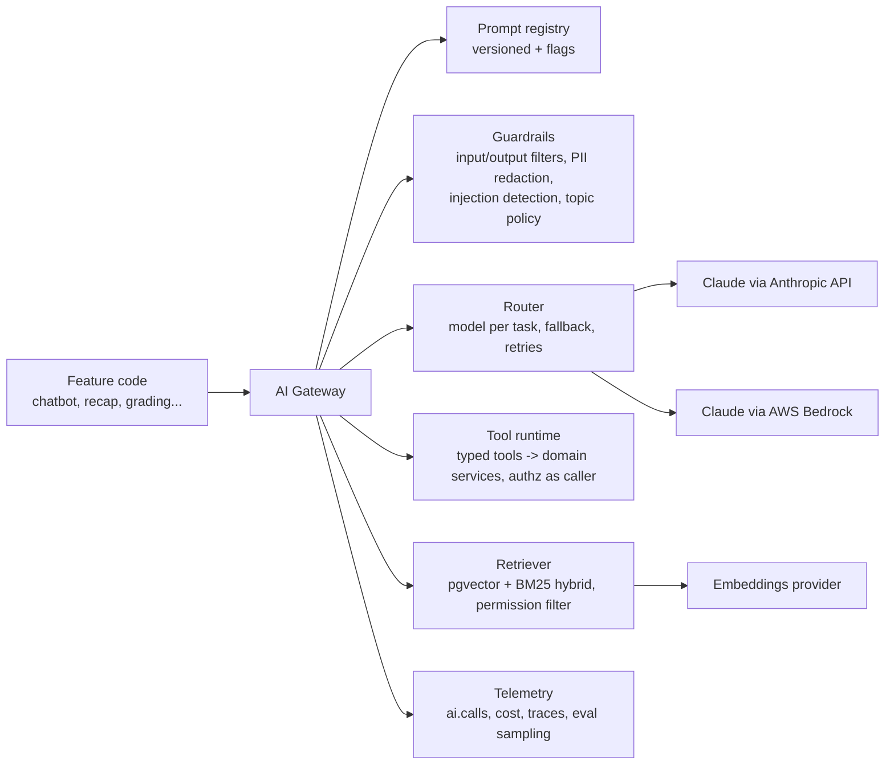

# 07 — AI Platform: Gateway, Chatbot, Consent Booking, Copilots

---

## 1. Principles
1. **Grounded, not creative**, for anything factual: prices, policies, schedules and availability come from tools and APIs, never from the model's memory.
2. **Human in the loop** for anything a customer sees about their child's learning (recaps, reports, grades). The tutor or staff approves before send, unless a feature flag allows auto-send after review metrics are proven.
3. **Least data.** Send the model only the fields the task needs. Redact phone numbers, emails and addresses before LLM calls unless the task needs them (e.g. composing a WhatsApp message happens **after** the model, through templates).
4. **No training on customer data.** Use providers and contract terms with zero data retention where available. Process in-region (AWS Bedrock ap-south-1 / cross-region inference profile per data-residency decision) or through the Anthropic API under the DPA.
5. **Everything measured.** Every call is logged with feature, prompt version, tokens, cost, latency, guardrail flags and outcome. Every prompt has an eval suite.

---

## 2. AI Gateway (module `ai`)



### 2.1 Model routing (configuration, not code)

| Task class | Default model | Notes |
|---|---|---|
| Customer chat (website/WhatsApp/portal) | `claude-sonnet-5-5` | Tool use + streaming |
| Classification, extraction, triage, lead scoring, PII detection | `claude-haiku-5-5` | Cheap, fast |
| Long-document reasoning (monthly report from 12 transcripts, curriculum mapping), hard grading | `claude-opus-5-5` | Batch/async only |
| Embeddings | Configurable provider (e.g. Voyage, or Cohere/Titan via Bedrock), dim 1024 | Re-embedding job on provider change |

Model IDs live in `ai.prompt_versions.model`, so upgrades are a config change plus an eval run. Use prompt caching for long system prompts and knowledge preambles. Use the Batch API for nightly bulk jobs (recaps backlog, report drafts).

### 2.2 Guardrails
- **Input:** length caps, rate limits, prompt-injection heuristics + classifier, a blocklist of jailbreak patterns, and a topic policy (education, Tutrain services, account help).
- **Retrieval:** documents carry `audience` (public/customer/staff) and owner ACLs. The retriever filters by the caller's permissions **before** ranking. Retrieved text is wrapped as untrusted data.
- **Tools:** each tool runs with the **caller's** identity and permissions (an anonymous visitor can only use public tools). Write tools (book demo, create ticket, reschedule) need explicit user confirmation in the conversation and an idempotency key.
- **Output:** PII/secret leakage scan, a price/policy claim checker (every number in the reply must appear in a tool result or a retrieved document, else regenerate or hedge), and a safety classifier for minors' contexts.
- **Fallback:** on provider error or a guardrail block, return a graceful message plus form/handoff options. The chat never hangs.

### 2.3 Cost controls
Per-feature daily budgets, per-anonymous-session token caps, per-user caps on the logged-in assistant, alerts at 80%, and automatic downgrade to a smaller model or a form-only mode at 100%.

---

## 3. Knowledge base for the website assistant

| Source | Sync trigger | Chunking |
|---|---|---|
| Payload CMS pages, FAQs, policies, blog | `cms.page.published` webhook | By heading section, ≤ 500 tokens, with URL + anchor |
| Catalogue (products, prices per market, what's included) | `product.published`, price changes | One structured doc per product per market. Prices are **also** fetched live by a tool at answer time |
| Tutor public profiles | `tutor.profile.published` | One doc per tutor (subjects, boards, languages, bio) |
| Operational facts (timings, how classes work, tech requirements, refund process) | CMS "Assistant Facts" collection | Short atomic facts |

Hybrid retrieval: pgvector cosine + Postgres FTS, merged with reciprocal-rank fusion, then reranked top 8. Only `published=true` content of the current version is retrievable.

---

## 4. Website and WhatsApp sales assistant

### 4.1 Capabilities
1. Answer questions with citations (links to pages).
2. Qualify: learner grade, board/curriculum, subjects, goals (exam, grades, confidence), country/time zone, preferred schedule, budget sensitivity.
3. Recommend 1–3 products with **live prices** for the visitor's market.
4. Show available demo slots (live availability across approved tutors) in the visitor's time zone.
5. **Book a demo with consent** (4.3).
6. Capture the lead even when no booking happens, with consent.
7. Hand off to a human (live chat in the CRM inbox during working hours, otherwise WhatsApp or a callback task).
8. Answer post-booking questions ("how do I join?", "can I reschedule?").

### 4.2 Tools exposed to the model (public scope)

| Tool | Input | Output | Side effects |
|---|---|---|---|
| `search_knowledge` | query | top passages + URLs | none |
| `get_catalog_options` | grade, board, subjects[], market | products with live prices, sessions, features | none |
| `get_demo_slots` | subject, grade, board, market/tz, date range | up to 8 slots (opaque slot IDs, local times) | none (slots hold only at booking) |
| `start_contact_verification` | phone or email, channel(whatsapp/sms/email) | challenge_id | sends OTP (rate-limited) |
| `verify_contact` | challenge_id, code | verified contact token | marks identity verified |
| `record_consent` | contact token, purposes[], notice_version, guardian_confirmed(bool), learner_is_minor(bool) | consent_id | writes the consent ledger |
| `create_or_update_lead` | contact token, consent_id, qualification fields, utm (from page context) | lead_id | creates/dedupes lead |
| `book_demo` | lead_id, consent_id, slot_id, learner first name, notes | demo_id, confirmation | creates demo (tx), holds tutor slot, notifies |
| `request_handoff` | reason, urgency | ticket/chat id | notifies on-duty counsellor |

The model never sees raw OTP codes or the full phone number after verification. Tools return masked values (`+91 98•••••210`).

### 4.3 Consented demo booking flow

```mermaid
sequenceDiagram
  participant U as Visitor
  participant B as Assistant
  participant T as Tools (API)
  U->>B: "Need maths tutor for my son, grade 9 CBSE"
  B->>T: get_catalog_options / get_demo_slots
  B-->>U: Recommends plan, offers 3 demo slots (local time)
  U->>B: Picks Sat 5 pm
  B-->>U: Asks: name, "Are you the parent/guardian?", phone
  U->>B: Provides; confirms guardian
  B->>T: start_contact_verification(phone, whatsapp)
  B-->>U: "Enter the 6-digit code sent on WhatsApp"
  U->>B: 482913
  B->>T: verify_contact
  B-->>U: Consent card (rendered UI, not free text):<br/>purposes: book demo + contact about it [required]<br/>class recording for quality & your access [required for demo]<br/>WhatsApp updates & offers [optional]<br/>links: Privacy Notice v3, Terms
  U->>B: Taps "I agree" (+ optional toggles)
  B->>T: record_consent(purposes, notice v3, guardian_confirmed=true, minor=true)
  B->>T: create_or_update_lead + book_demo(slot)
  T-->>B: demo confirmed
  B-->>U: Confirmation + add-to-calendar + "Join" link will come on WhatsApp
  T->>T: notify counsellor + tutor, reminders scheduled
```

Rules:
- The consent card is a **structured UI component** that the widget renders from a `consent_request` message type. The model cannot invent consent text. The notice version comes from CMS.
- Required vs optional purposes are separate. Marketing consent is never bundled with booking.
- If the visitor says they are the learner and indicates they are under 18 → the assistant asks for guardian details and sends the OTP/consent request to the **guardian's** phone (verifiable guardian consent). No booking until the guardian verifies.
- Every booking can be traced: `demo.consent_id → consents.evidence {otp_challenge_id, conversation_id, message_id, ip_hash, ua, notice_version}`.
- Withdrawal: "stop", the unsubscribe link, or a portal toggle → `consent.withdrawn` → suppression lists updated within 1 h.

### 4.4 Widget
- Built in `apps/web` as a lightweight island (≤ 40 KB gz). Loaded on interaction or after idle, as today, but self-hosted, versioned and CSP-compliant.
- Streams over SSE from `POST /v1/assistant/conversations/{id}/messages`.
- Supports rich message types: text, citations, product cards, slot picker, consent card, OTP input, handoff status.
- Accessible (keyboard, screen-reader live region) and mobile-first.
- Page context (URL, page type, board/grade from the page) is sent to personalise the opening line.

### 4.5 WhatsApp
- Inbound webhook → the same orchestrator with `channel=whatsapp`. Formatting adapts (no markdown tables, lists ≤ 10 via interactive list messages, buttons for slots/consent).
- Consent on WhatsApp uses interactive buttons. Evidence = WhatsApp message ID + timestamp.
- Outside the 24 h customer-service window, only approved templates are sent.

---

## 5. Logged-in assistant (guardian/learner portal) `[P2]`
Tools are scoped to the caller's own data via the domain services' authorisation:
`get_my_schedule`, `get_session_recap(session_id)`, `request_reschedule(session_id, slot)` (policy-checked, needs confirmation), `get_fee_status`, `get_attendance_summary`, `search_my_classes(query)` (RAG over **own** transcript chunks, returns timestamped citations that deep-link into the recording player), `create_ticket`.

Learner mode (minor) adds study-helper guardrails: explain, don't just answer homework (Socratic mode), age-appropriate content, no external links except whitelisted educational ones.

---

## 6. Tutor and Academics copilots

| Feature | Trigger | Output | Human step |
|---|---|---|---|
| Session log pre-fill | `transcript.ready` | Topics covered → curriculum node IDs, homework given, observations | Tutor confirms/edits in ≤ 60 s |
| Session recap for family | `transcript.ready` | 5–8 bullet recap, key concepts, homework, encouragement line | Tutor approves → sent via WhatsApp/email + portal |
| Homework/quiz generator | Tutor action or recap | Questions mapped to topics, with answers and difficulty | Tutor selects/edits → question bank (`source=ai`, `reviewed_by`) |
| Subjective grading assist | Submission | Rubric scores + feedback draft | Tutor confirms the score |
| Monthly progress report | Scheduled (month end) | Narrative from attendance, logs, tests and recaps | Tutor or academics approves → PDF |
| PTM brief | 24 h before PTM | One-page brief for the tutor: progress, concerns, talking points | — |
| Class quality audit | Sample of sessions/week (+ all flagged) | Talk-time ratio, questions asked, learner engagement, adherence to plan, safety/professionalism flags | QA auditor reviews and scores; feeds the tutor quality score |
| Demo assessment helper | Demo transcript | Level assessment + recommended product | Tutor confirms → CRM demo feedback |

## 7. Ops, Sales, Support, Finance and Marketing AI

| Feature | Model | Notes |
|---|---|---|
| Lead scoring + next best action | Haiku + rules | Features: source, engagement, demo feedback, response latency. Explanations shown |
| Counsellor reply drafts (WhatsApp/email) | Sonnet | Grounded in the lead timeline + catalogue. Counsellor sends |
| Call summaries (if telephony recordings are enabled) | Sonnet | Into the lead timeline |
| Ticket triage + suggested reply | Haiku / Sonnet | Category, priority, sentiment. Reply grounded in policies |
| Tutor match ranking | Rules + Haiku explanation | Hard constraints (approval, availability) in SQL. The model only explains or re-ranks the top 10 |
| Churn-risk alerts | Rules + model | Signals: attendance drop, reschedules, low ratings, overdue fees, negative sentiment |
| Finance anomaly flags | Rules + Haiku | Unusual refunds, duplicate payments, payout outliers |
| SEO/content drafts | Sonnet / Opus | Briefs and drafts in Payload as **draft** only. An editor reviews and fact-checks. No auto-publish |
| Ask-the-data (staff) | Sonnet + semantic layer | Read-only SQL over approved views, permission-scoped. Shows the query used |

## 8. External AI integration surfaces `[P3]`
- **Internal MCP server** (`apps/mcp`): exposes read-mostly tools (search learners, session timeline, lead timeline, KPI queries) to staff using Claude desktop/web with their SSO identity and RBAC. Write tools need confirmation and are audit-logged.
- **Partner API** for B2B/school partners (enrollments, schedules, reports) with API keys.

## 9. Evaluation and quality
- Each prompt key has a golden set (≥ 50 cases) in `packages/domain/ai/evals/<key>/`: inputs, expected tool calls, rubric.
- CI runs evals on prompt/model changes. A regression of more than 3 points on any rubric dimension blocks the merge.
- Online metrics:
  - chatbot: containment rate, lead-capture rate, demo-booking rate, handoff rate, thumbs up/down, hallucination reports;
  - copilots: tutor edit distance on drafts, approval rate, time saved.
- Red-team suite: prompt injection via retrieved docs, requests for other users' data, price manipulation, unsafe content for minors, and jailbreaks. Run weekly.

## 10. Data protection specifics
- Transcripts and recaps are personal data of minors. Process only for the purposes in the consent (`recording`, `ai_processing`). If a guardian withdraws `ai_processing`, AI jobs for that learner are skipped and manual flows are used.
- Logs of prompts/completions: 30-day retention, PII-redacted, access restricted to `ai:debug`.
- Provider DPAs, sub-processor list and data-residency choice documented in [09](./09-SECURITY-COMPLIANCE.md).
