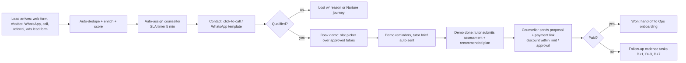

# 11 — Department Workflows and Console Design

How each team works day to day in v2, which screens they use, and what the system automates. Use it for UX design and for writing user stories.

---

## 0. Console shell (all staff)
- **Left nav** = the department workspaces the user has permission for. **Top bar** = global search (Cmd+K), "Create" menu, notifications, a "My tasks" counter.
- **Home** = "My work": tasks due today, SLA timers about to breach, items assigned to me, and saved views.
- **Entity 360 pages** (shared by every department, sections shown by permission): Guardian/Account, Learner, Tutor, Lead, Order, Session. Each has a timeline (all events, messages, notes), related records and quick actions.
- **Saved views** on every table (filters + columns), shareable with the team.

---

## 1. Sales / Counselling (CRM)

| Screen | Purpose |
|---|---|
| Lead inbox (list + kanban by stage) | Prioritised by score and SLA. Bulk actions |
| Lead 360 | Timeline (chatbot transcript, WhatsApp thread, calls, notes), qualification form, demos, proposals, consent status |
| Demo calendar | Available tutor slots by subject/grade, booked demos, no-shows |
| Proposal builder | Catalogue picker, custom plan builder (subject × sessions), promo/discount, instalments, payment link |
| My targets | Personal funnel, conversion, revenue vs target |

Automations: speed-to-lead alerts, auto-reassign on SLA breach, demo no-show → rebook task, payment-link expiry nudges, lost → nurture journey after 30 days.

---

## 2. Operations

**Daily rhythm:** morning live board → handle exceptions → assign tutors to new enrollments → clear the review queues.

| Screen | Purpose |
|---|---|
| **Onboarding queue** | Paid orders waiting for a tutor/schedule. Tutor match suggestions (ranked, with reasons). Confirm schedule → system creates the Meet space + series + notifications |
| **Live board (today)** | Every session in a timeline: upcoming / live / tutor-late (T+5) / learner-not-joined / ended / outcome. One-click actions: call tutor, WhatsApp guardian, assign substitute, mark technical issue |
| **Reschedule & cancellation requests** | Policy evaluation shown (within/outside policy, credits impact). Approve/deny/propose |
| **Attendance review** | Partial/ambiguous/no-data items with an evidence panel. Decide outcome with reason |
| **Unmapped conferences** | Map to a session/enrollment or dismiss |
| **Tutor leave & substitution** | Affected sessions, substitute suggestions, bulk notify |
| **Enrollment management** | Pause/resume, change tutor (with continuity notes), change schedule, transfer credits, extend validity |
| **Batches** | Create batch, members, capacity, schedule, tutor |
| **Pipeline health** | Attendance/recording ingestion metrics |

Automations: series generation, reminders, tutor-late alerts, make-up creation on tutor no-show, low-credit renewal triggers, auto-pause on overdue fees (if enabled).

---

## 3. Academics and Quality

| Screen | Purpose |
|---|---|
| Curriculum manager | Board/grade/subject tree, chapters/topics/objectives, per academic year |
| Learning plans | Templates per product. Per-enrollment progress vs plan |
| Question bank & tests | Author/review questions (AI-generated items need review), assemble tests |
| Resource approvals | Tutor-uploaded resources: approve/reject |
| QA audits | Weekly sample + flagged sessions. AI pre-analysis. Rubric scoring. Feedback to tutor |
| Tutor quality | Scorecards (punctuality, ratings, QA, retention, report timeliness). Coaching actions |
| Reports approval | Monthly progress reports pending approval |
| PTM tracker | Due/scheduled/completed PTMs per enrollment vs the plan entitlement |

---

## 4. Tutor Acquisition (Talent/HR)

`Applied → Screened → Subject test → Demo-teach interview → Verification (ID, docs, background) → Agreement e-sign → Training → Approved for subjects → Active`

Screens: applicant pipeline (kanban), application 360 (CV, scores, interview recording, rubric), approvals matrix (tutor × subject × board × grade), onboarding checklist, Workspace account provisioning (automated via the Admin SDK), offboarding.

This replaces the Google Sheet candidate list and the unauthenticated sheet-row deletion.

---

## 5. Finance

| Screen | Purpose |
|---|---|
| Collections | Dues ageing by bucket, instalments due, reminders sent, promise-to-pay notes, pay-link resend |
| Payments | All gateway payments with status. Unmatched/failed. Manual payment entry (with proof upload + approval) |
| Refunds | Requests with policy calculation. Approve → gateway refund → credit note |
| Invoices & credit notes | Search, regenerate PDF, GST summary per period, export |
| Reconciliation | Daily gateway settlement vs ledger. Mismatch worklist |
| Tutor payouts | Cycle view: earnings per tutor (sessions, rates, adjustments), tutor disputes, approve, payout file/API, payslips, TDS summary |
| Rate cards | Global table, tutor overrides, enrollment overrides, effective dates, preview impact |
| Revenue | Bookings, cash, recognised and deferred revenue, refunds, margin by product/market/tutor |

Controls: maker-checker on refunds above a threshold, payout approval, manual payments and rate-card changes. All are audit-logged.

---

## 6. Marketing

| Screen | Purpose |
|---|---|
| CMS (Payload) | Pages, landing blocks, blog, FAQs, testimonials, banners, redirects, assistant facts |
| SEO dashboard | Indexed pages, CWV, top queries (Search Console API), broken links, redirect registry health |
| Segments & campaigns | Rule-based segments. WhatsApp/email/SMS campaigns and journeys. Consent-aware audience counts |
| Attribution | Channel → lead → demo → paid → LTV. CAC by channel. Offline-conversion sync status |
| Chatbot insights | Top questions, unanswered questions (→ create a FAQ), conversion by page, handoff reasons |
| Reviews | Google Business reviews sync, testimonial curation, review requests after positive NPS |
| Referral programme | Codes, rewards, fraud flags |

---

## 7. Support

Omnichannel inbox (portal tickets, email, WhatsApp, chatbot handoffs) with SLA timers, AI triage and suggested replies, macros, a links panel (learner/session/order context), and CSAT. Escalation paths: Ops (session issues), Finance (billing), Academics (tutor quality), Safeguarding (restricted).

---

## 8. Super Admin (Director) — Command Center
- **Company KPIs:** MRR, collections, outstanding, active learners, sessions delivered, attendance health, tutor utilisation, funnel conversion, churn, NPS, LTV/CAC, AI spend.
- **Drill-downs** into every department dashboard.
- **Governance:** roles and permissions, access review, audit log, policies (refund, reschedule, attendance thresholds), price books, feature flags, integrations health.
- **Approvals inbox:** above-limit discounts, large refunds, payout cycle sign-off, rate-card changes.

---

## 9. Guardian and learner experience (app.tutrain.com)

| Area | Guardian | Learner |
|---|---|---|
| Home | Next class per child, join button, alerts (fees due, reschedule decisions), recap of last class | Today's classes, homework due, streak |
| Schedule | Calendar per child. Self-service reschedule within policy. Add to calendar | Calendar |
| Learning | Recaps, recordings (signed playback), progress vs plan, test results, reports, PTMs | Recordings, notes, homework, tests, "Ask my classes" `[P3]` |
| Billing | Plans and credits remaining, invoices, pay dues, renew, refund request | Hidden |
| Support | Chat assistant, tickets, report a concern | Report a concern, assistant (study mode) |
| Settings | Children, notification preferences, consents (view/withdraw), devices, data export | Profile, Google sign-in link |

## 10. Tutor experience

| Area | Features |
|---|---|
| Home | Today's sessions, join, learner briefs, pending logs/recaps to approve |
| Schedule & availability | Weekly template, leave requests, extra slots, Google Calendar sync |
| My learners | Per-enrollment learning plan, progress, past recaps, notes, PTMs |
| Class tools | Session log (AI pre-filled), recap approval, homework/quiz builder, grading queue |
| Resources | Upload (with approval), library |
| Earnings | Sessions conducted, rates, monthly statement, disputes, payslips, TDS certificates |
| Quality | Own scorecard, QA feedback, punctuality |
